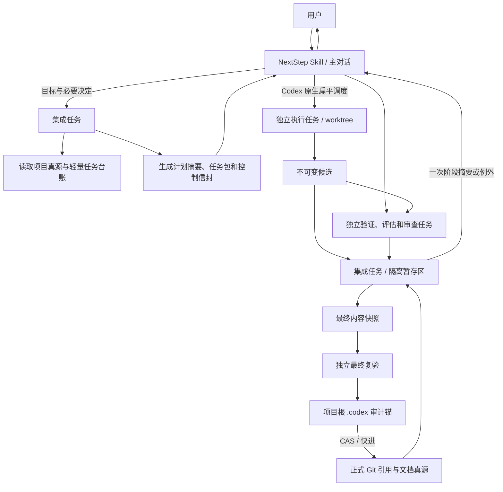

# S4 技术架构

状态：已会签
记录日期：2026-07-14
会签日期：2026-07-14
会签结论：通过
所属阶段：S4 技术架构
上游真源：

- `docs/product-specs/002-complete-project-blueprint.md`
- `docs/product-specs/003-user-journey.md`
- `docs/product-specs/004-capability-map.md`
- `docs/product-specs/005-stage-document-contracts.md`
- `docs/product-specs/006-product-carrier-decision.md`
- `docs/product-specs/007-s3-skill-interaction-contract.md`
- `docs/product-specs/008-downstream-interaction-product-acceptance-contract.md`
- `docs/design-docs/s3-skill-interaction-source.md`
- `docs/architecture/p2-technical-prep.md`
- `docs/architecture/009-s4-technical-input-supplement.md`
- `PROJECT_ROUTE_LOCK.md`

## 1. 文档目标

本文定义 NextStep 在 `Skill 主载体 + 文档真源承载` 路线下的技术架构候选，回答：

- Skill 如何把用户对话转成可审查的项目真源和执行任务包。
- 主对话、集成和执行职责如何映射到 Codex 原生任务与 worktree。
- 项目、阶段、交付物、里程碑、变更和验收如何建模。
- 如何在不引入常驻服务或数据库的前提下维护任务状态、幂等和恢复。
- 多文件回写、候选验证、最终复验和正式状态提升如何避免误报成功。
- Codex 能力不完整时如何进入 `full`、`manual-isolated` 或 `blocked`。
- 高风险假设如何在后续实现前通过本地探针验证。

本文是后续 P3 版本与里程碑拆解的技术真源候选。用户会签前，不得将其视为已生效架构。

## 2. 明确非目标

- 不定义 V1、V2、Backlog、大里程碑或小里程碑范围。
- 不生成具体执行任务包、测试报告或真实验收结论。
- 不编写产品实现代码，不冻结目录和文件的最终物理拆分。
- 不恢复 `Web / UI` 候选分支，不选择前端框架或部署平台。
- 不建设常驻本地服务、远程控制面、中央数据库或通用多 Agent 编排平台。
- 不建设 `Project Provenance Store`，不长期统计每个 Agent 的文件贡献，也不提供按 Agent 贡献回退。
- 不保存完整宿主任务对话、Agent 内部推理或与任务无关的聊天内容。
- 不把 Codex 文档中的接口存在性包装为当前宿主组合已经通过预检。

## 3. 技术目标与架构原则

### 3.1 技术目标

1. 项目事实独立于聊天存在，主对话关闭、压缩或重开后仍可恢复。
2. 用户确认、阶段门禁和正式状态只能通过受控写入生效。
3. 主对话只负责沟通、决策和扁平调度，后台过程不污染用户上下文。
4. 修改型任务、验证任务和最终集成具有明确的不可变输入与输出身份。
5. 任一写入、验证或 CAS 失败都不得把项目误报为已会签、已通过或已集成。
6. 架构可在不同 Codex 版本和宿主能力下确定降级，而不是依赖隐含行为。
7. 当前技术基线保持轻量、项目内可审查、可移除，不提前建设平台能力。

### 3.2 架构原则

- **文档是真源**：产品和项目事实以版本化 Markdown/JSON 文件为准，聊天与宿主任务状态不是事实真源。
- **Git 是内容身份与正式引用机制**：使用提交、树和 blob 标识不可变内容，使用预期旧值 CAS 或快进移动正式引用。
- **Skill 是交互入口，不是数据库**：Skill 解释协议、调用辅助工具和调度任务，不在模型上下文中维护唯一状态。
- **按需执行，不常驻**：辅助运行时每次命令启动、读取、校验、原子写入后退出。
- **单写者提交，独立角色验证**：集成职责是正式项目状态的唯一写入口，但不得批准自己的候选或最终快照。
- **默认拒绝不确定性**：身份、基线、项目根、能力或恢复状态无法证明时进入人工隔离或阻塞。
- **最小数据**：只保存恢复、验收和正式提升所需的结构化字段及证据引用。

## 4. 候选技术栈与裁决

### 4.1 推荐方案

| 层次 | 推荐选择 | 选择理由 |
|---|---|---|
| 主交互载体 | Codex Skill Markdown | 与已会签载体裁决一致；可被用户显式调用，可携带流程与边界说明 |
| 按需辅助运行时 | TypeScript + 当前 Node.js LTS | 与 Codex TypeScript SDK 兼容，适合 JSON Schema、Git 命令、文件事务和跨平台 CLI；不要求常驻服务 |
| 结构化契约 | JSON Schema + 规范化 JSON | 可生成、验证和版本化任务包、信封、台账与凭证；未知版本可拒绝处理 |
| 人类真源 | Markdown + 明确元数据字段 | 与现有项目文档体系一致，可直接审查、会签和 Git diff |
| 内容与版本 | Git 原生对象与引用 | 提供不可变内容身份、分支/worktree 隔离和 compare-and-swap 基础 |
| 宿主适配 | Codex 原生协作工具优先，App Server/SDK 作为可选适配 | 保留当前 Codex 内自然使用方式；需要程序化线程生命周期时再启用可选适配 |
| 测试 | Node 内置测试运行器 + fixture Git 仓库 + shell 断言 | 足以覆盖纯函数、Schema、状态机、故障注入和真实 Git CAS，不提前引入大型测试框架 |

Node 的最低版本不在 S4 固定为某个具体大版本；实现时必须同时满足所选 Codex SDK 的最低要求与当时受支持的 Node LTS，并在锁文件和构建配置中固定。

### 4.2 备选方案 A：纯 Skill + Shell

优点：依赖最少，最接近当前文档仓库。

不选原因：复杂 JSON 契约、状态迁移、跨平台路径、故障注入和事务恢复使用 Shell 难以稳定验证；容易退化为不可维护的字符串处理。

### 4.3 备选方案 B：Python 按需工具

优点：标准库覆盖文件、JSON、进程和测试，原型速度快。

不选原因：Codex SDK 与 App Server 的首要程序化集成路径更偏向 TypeScript/Node；选择 Python 会增加双语言适配或放弃一部分直接复用。若 P3 证明完全不需要 Codex SDK，Python 仍可通过技术 Change Request 重新评估。

### 4.4 备选方案 C：SQLite + 常驻本地服务

优点：并发事务、查询和任务状态维护更直接。

不选原因：当前产品不需要常驻控制面或复杂查询；会引入进程生命周期、迁移、锁、备份和服务安全问题，明显扩大项目。若未来真实负载证明文件台账无法满足，再单独进入变更分流。

### 4.5 备选方案 D：独立远程编排服务

不选原因：会把 NextStep 扩大为通用多 Agent 平台，并引入账户、鉴权、租户、远程存储、部署和运维，与当前产品非目标冲突。

## 5. 总体架构



### 5.1 系统边界

| 边界 | 职责 | 不负责 |
|---|---|---|
| 主对话 Skill | 用户沟通、必要确认、消费控制信封、创建/继续/归档独立任务、显示最小摘要 | 读写项目文件、审阅差异、运行验证、维护唯一状态 |
| 集成任务 | 读取真源、判定阶段、生成任务包、维护轻量台账、集成候选、生成最终快照和审计锚、执行 CAS | 联系用户、自我批准验证或验收 |
| 执行任务 | 按单一任务包产出修改、测试、文档、评估或审查结果 | 扩大范围、修改正式引用、读取完整主对话 |
| 按需辅助工具 | 项目解析、Schema 校验、摘要、原子文件写入、Git 快照与 CAS、门禁断言 | 业务决策、用户沟通、后台常驻调度 |
| Codex Adapter | 映射线程、turn、子 Agent、沙箱、worktree、归档和恢复能力 | 决定项目阶段、替代 NextStep 台账或正式真源 |
| 文档/Git 存储 | 承载项目事实、状态、任务最小台账、审计锚和不可变内容 | 保存完整对话或长期 Agent 贡献画像 |

### 5.2 依赖方向

领域规则和 Schema 不依赖 Codex。Codex Adapter 依赖领域契约，Skill 调用领域能力和 Adapter。这样可在 Codex 接口变化时替换适配层，而不重写项目状态与门禁规则。

## 6. 项目内数据布局

S4 只冻结逻辑位置和职责，P3/P4 可在不改变契约的前提下决定最终文件拆分。

```text
<project>/
├── PROJECT_ROUTE_LOCK.md
├── docs/
│   ├── product-specs/
│   ├── design-docs/
│   ├── architecture/
│   ├── exec-plans/
│   ├── change-requests/
│   ├── qa/
│   └── releases/
└── .codex/
    ├── operations-log.md
    ├── verification-report.md
    └── runtime/
        ├── registry.json
        ├── checkpoint.json
        ├── messages/
        ├── packages/
        └── reviews/<task-id>/
```

约束：

- `.codex/runtime/` 是 `refs/nextstep/control` 所指控制快照的工作镜像，只保存当前计划和恢复所需的最小台账，不是长期 Agent 溯源库。
- `refs/nextstep/control` 是永不被工作树检出的专用 Git ref；其提交只承载轻量任务台账、检查点、不可变任务包/消息引用和 outbox。每次控制状态转换都以该 ref 的旧 OID 为 CAS 前置条件。
- `registry.json` 和 `checkpoint.json` 必须可由控制 ref、正式真源、有效控制消息和宿主任务关联重新核验；工作镜像损坏时从控制 ref 重建，控制 ref 断链、倒退或冲突时停止自动推进。
- 任务包、控制消息和结果信封按内容摘要不可变保存；修改语义必须生成新代际或新尝试。
- 大型 stdout/stderr、临时截图和诊断文件放在项目外受控临时目录，项目内只保存摘要与引用。
- 被忽略文件、密钥、Token、完整对话和内部推理不得复制到运行台账。

## 7. 核心数据模型

### 7.1 领域对象

| 对象 | 最小身份 | 核心关系 |
|---|---|---|
| Project | 规范化项目根 + 仓库身份摘要 | 包含阶段、真源、版本、里程碑和交付物 |
| Requirement Set | 文档路径 + 内容摘要 + 状态 | 关联产品定义和 Change Request |
| Product Definition | 文档路径 + 内容摘要 + 会签状态 | 约束原型、技术方案和产品验收 |
| Interaction Source | 文档路径 + 内容摘要 + 会签状态 | 版本化引用 Product Definition、Technical Plan、适用 Milestone 和 Acceptance Evidence/Report；任一被引用内容变化时，旧验收映射失效并重新判定 |
| Technical Plan | 文档路径 + 内容摘要 + 状态 | 约束后续版本与工程实现 |
| Version | 稳定 ID | 聚合大里程碑；具体实例留给 P3 |
| Major Milestone | 稳定 ID | 聚合小里程碑和集成验收 |
| Small Milestone | 稳定 ID | 产生执行任务包和验收要求 |
| Stage | 阶段 ID + 路线代际 | 记录当前阶段、允许前驱/后继、所需真源和阶段出口；一个 Stage 可产生多次 Stage Gate 判定 |
| Stage Gate | 阶段 ID + 门禁代际 | 绑定 DoD、证据和结论 |
| Deliverable | 路径/外部引用 + 内容摘要 | 绑定来源真源、状态和验收证据 |
| Change Request | 稳定 ID + 文档摘要 | 关联受影响真源和分流结论 |
| Acceptance Profile | 路线 ID + 配置摘要 | 启用交互、产品和条件性 UI 验收 |

### 7.2 执行控制对象

| 对象 | 作用 | 最小字段 |
|---|---|---|
| Project Context | 唯一定位项目和当前阶段 | 规范根、仓库身份、正式引用、阶段、读取时间 |
| Capability Preflight | 证明宿主与项目组合可采用哪种运行模式 | 宿主/版本、项目、权限、检测项、证据摘要、有效期、`full / manual-isolated / blocked` 结论 |
| Execution Packet | 限定一个独立任务 | 任务/计划 ID、控制身份、基线、目标、输入、边界、输出、验收、上报规则 |
| Task Registry Entry | 恢复当前任务状态 | 任务 ID、代际、尝试、状态、依赖、宿主任务 ID、任务包摘要、候选摘要 |
| Control Envelope | 驱动派发和代际变化 | Schema 版本、消息 ID、任务、代际、摘要、去重键、有效期、确认要求 |
| Generation Snapshot | 恢复最高有效代际 | 各计划/任务最高代际、未确认墓碑和摘要 |
| Candidate Change | 用户确认前的真源修改 | 基线、目标文件、before 摘要、after 摘要、影响和会签后果 |
| Write Transaction | 组织一次正式真源回写 | 事务 ID、候选摘要、目标清单、预期基线、准备/验证/提升状态、失败与恢复证据 |
| Immutable Candidate | 独立任务待验证产物 | 基线提交/树、候选提交/树、内容摘要、任务控制身份 |
| Final Content Snapshot | 待最终复验的完整项目状态 | 父基线、最终树/提交、验证运行 ID、纳入的候选和门禁清单 |
| Verification Credential | 项目外最终复验结果 | 最终快照摘要、预期正式基线、验证任务、结论、证据摘要、时间 |
| Audit Anchor | 项目内最终结论锚 | 父快照、凭证摘要、白名单差异、验证任务与结论 |
| Anchor Proof | 项目外独立锚验证结果 | 审计锚 OID、凭证摘要、预期正式基线、锚验证任务、白名单/子树校验结论、生成时间 |

这些控制对象只追踪当前执行闭环和正式状态正确性，不建立 Agent 的长期文件贡献归属。

### 7.3 契约规则

- 每类 JSON 必须包含 `schema_version`，未知主版本拒绝处理。
- 结构化契约使用 RFC 8785 JSON Canonicalization Scheme 编码为无 BOM 的 UTF-8 字节，并以 `sha256:<hex>` 标识摘要；未知算法拒绝处理。
- JCS 字符串保留原始 Unicode 码点，不做隐式 Unicode 归一化；Markdown 和其他交付物按 Git blob 原始字节计算摘要，不改写换行。路径采用相对规范项目根的 UTF-8 路径并执行平台感知的大小写/符号链接检查，禁止 `..` 越界。
- ID 只用于关联，正确性同时校验内容摘要、代际、基线和宿主关联。
- 外键缺失、重复控制消息冲突、未知状态或摘要不一致均 fail closed。

## 8. 状态机与阶段门禁

### 8.1 真源状态机

```text
草稿 -> 待会签 -> 已会签 -> 已归档
  |        |          |
  +------> 退回 <-----+
```

- `已会签` 内容不得原地改写后继续保留旧会签身份。
- 修改已会签内容必须通过 Change Request 或对应变更入口生成新候选与新会签结论。
- 归档只改变生命周期定位，不删除历史内容与会签证据。

### 8.2 阶段门禁状态

门禁结论只能是：

- `通过`：全部必需交付物、验收项和证据满足，可进入下一阶段。
- `退回`：已有证据证明关键要求不满足，回到明确修复入口。
- `需讨论`：存在产品取舍、范围变化或验收口径冲突，等待用户决定。
- `阻塞`：缺权限、环境、外部输入或可信证据，当前不能判定。

阶段推进必须同时满足：

1. 当前阶段与路线锁一致。
2. 必需真源存在且状态有效。
3. DoD 的每一项有证据和结论。
4. 所需的交互、产品及条件性 UI 验收类型均通过。
5. 最终内容快照复验、审计锚验证和正式引用 CAS 成功。
6. 用户明确确认需要用户会签的阶段出口。

### 8.3 执行任务状态

```text
已准备 -> 待派发 -> 派发待确认 -> 排队中 -> 执行中
  -> 待候选验证 -> 待集成 -> 待最终复验 -> 待正式提升
  -> 已集成 -> 已归档
```

任一活动状态可以进入 `阻塞` 或 `失败`。计划或基线变化通过新代际和撤销墓碑使旧尝试失效，不反向改写旧记录。

## 9. 项目上下文解析

项目解析顺序：

1. 读取用户显式提供的绝对路径或当前宿主工作区候选。
2. 解析符号链接并进行路径规范化，定位最近且唯一的 `PROJECT_ROUTE_LOCK.md` 与 Git 根。
3. 检查路线锁声明的项目与 Git 根关系；嵌套或多个候选根时停止并向用户展示规范路径。
4. 校验读取/写入权限和允许工作区边界。
5. 计算仓库身份、当前正式引用与工作区状态摘要。
6. 由用户确认规范项目根后，才允许生成写入候选。

项目上下文不得仅用项目名称、聊天标题、当前 shell 目录或 worktree 路径猜测。切换项目时必须重新执行解析和确认。

## 10. AI 交互与职责边界

### 10.1 主对话

主对话可以：澄清目标、解释阶段、展示计划摘要、接收用户决定、消费 `dispatch-ready`、创建/继续/归档独立任务、展示最终摘要。

主对话不可以：读取项目文件、修改项目、运行开发/测试/评估/审查、解析完整日志、直接批准阶段或把未持久化决定称为已生效。

### 10.2 集成职责

集成任务是当前执行链的单写入口：读取项目真源，准备任务包与台账，校验结果身份，在隔离暂存区整合候选，生成最终快照、审计锚并尝试 CAS。它不能联系用户，也不能替代独立验证。

### 10.3 执行职责

执行任务只接收当前任务的最小结构化包。信息不足时返回缺口；不得请求完整主对话或读取无关项目材料。修改型任务使用独立 worktree；验证、评估和审查默认只读，无法证明只读时使用一次性隔离副本并丢弃写入。

### 10.4 用户确认边界

需求冻结、产品/原型/交互/技术真源会签、载体裁决、变更最终分类和阶段门禁结论必须由用户明确确认。用户确认计划后，计划内普通任务可自动分派；路线、范围、不可逆动作、安全、显著成本或验收失败必须重新上报。

## 11. Codex 宿主适配

### 11.1 已核验的可用接口

截至 2026-07-14，官方 Codex 手册和本机 `codex-cli 0.144.1` Schema 证明以下能力存在：

- 主任务可直接委派子 Agent，默认只允许直接子层，适合物理扁平调度。
- 自定义 Agent、SDK 或 App Server turn 可设置只读或工作区写入沙箱。
- Codex App 可为任务创建受管 worktree，并支持任务查看、恢复和归档。
- App Server 提供线程 start/resume/fork/list/read/archive 和 turn start/steer/interrupt 及事件流。
- TypeScript/Python SDK 可程序化启动和恢复 Codex 线程。

上述证据只证明接口存在。实际宿主、版本、项目与权限组合必须通过能力预检。

### 11.2 两阶段能力预检

`host-bootstrap` 不读取或写入项目，只检查：

- 宿主标识和版本。
- 独立任务是否可创建、查询、继续和归档。
- 能否获得稳定宿主任务 ID 与创建结果。
- 能否设置或证明只读/工作区写入权限。
- 是否可以安全接收审批与阻塞结果。

只有 `host-bootstrap` 证明可创建和查询独立任务后，才创建一次性 `project-probe`。后者在隔离环境中检查：

- worktree 的精确起点和本地未提交改动行为。
- 任务包、控制信封和结果信封往返。
- 候选提交/树物化和只读验证隔离。
- 任务创建后确认丢失的恢复与去重。
- 最终内容快照、项目外凭证、审计锚、CAS 与归档。
- 探针失败后项目正式引用和业务真源保持不变。

能力证据必须绑定宿主、版本、项目、权限配置、检测时间和有效期。版本、权限或项目特征变化使旧证据失效。

### 11.3 三态裁决

| 模式 | 条件 | 允许行为 |
|---|---|---|
| `full` | 独立任务、候选、只读验证、控制确认恢复、最终复验与 CAS 全部可证明 | 计划内自动扁平分派和自动恢复 |
| `manual-isolated` | 自动创建/确认/归档不可靠，但用户可显式创建独立任务，且候选、验证和身份仍可绑定 | 只请求最小人工操作，继续保持任务与文件隔离 |
| `blocked` | 独立任务、不可变候选、验证隔离、精确最终复验或身份绑定无法保证 | 停止执行，不将同任务串行冒充严格隔离 |

Codex 的 `thread/rollback` 只影响对话历史且已经废弃，不得用作项目文件或正式状态回滚。

## 12. 调度、幂等与恢复

### 12.1 控制 ref、写者 claim 与 fencing

- 轻量台账的规范状态是 `refs/nextstep/control` 指向的不可变控制提交，不是活动进程内存或工作镜像。
- 每次 `registry-transition` 从控制 ref 读取旧 OID，生成父提交为旧 OID的新控制提交，再执行 `git update-ref refs/nextstep/control <new> <old>`；只有 CAS 胜者的状态生效，失败者必须丢弃本地候选并重读。
- 需要执行宿主副作用前，先以 CAS 写入 outbox 意图，再以第二次 CAS 取得 `claim_id`、`owner_id`、`lease_expires_at` 和单调递增 `fence_token`。只有持有当前最高 fence 的 claim 可以调用宿主。
- claim 到期只能通过新的控制 ref CAS 和更高 fence 接管。旧写者即使迟到，也不能持久化 ack、结果或状态；宿主调用同时携带稳定 `dedup_key` 与 fence。若宿主不能按去重标记查询/恢复创建结果，禁止 `full`。
- 宿主副作用接口必须由 Codex Adapter 暴露为原子 `create-or-return(effect_key, fence_token, payload_digest)`：接收端在同一临界区只接受该 `effect_key` 的最高 fence，并按稳定幂等键创建一次或返回原宿主任务 ID；“先查询、后创建”不满足该契约。旧 fence、同 fence 不同 payload 或无法证明原结果时必须拒绝，不得调用宿主创建。
- 只有 Adapter 或宿主能原子执行上述最高 fence + 幂等创建契约时才允许 `full`。若当前 Codex 表面只能提供非原子查询与创建，则自动降为 `manual-isolated`，由用户显式创建一次任务并把宿主任务 ID 绑定回原 outbox；无法绑定时为 `blocked`。
- 宿主副作用成功后以控制 ref CAS 写入 `dispatch-ack` 并关闭 outbox。进程在副作用前崩溃时新 claim 可继续；副作用后 ack 前崩溃时只能通过同一 `effect_key` 调用 `create-or-return` 恢复原任务，不能直接重建。
- 控制 ref 非快进、父链断裂、同一 fence 出现冲突或工作镜像与控制 ref 摘要不一致时 fail closed；人工修复必须保留冲突证据并生成更高代际恢复提交。

### 12.2 持久化顺序

1. 集成任务先持久化 Execution Packet、依赖满足事实和 `dispatch-ready`。
2. 主对话校验结构、最高代际缓存、有效期和宿主任务标记。
3. 创建独立任务并返回 `dispatch-ack`，包含消息 ID、去重键、宿主任务 ID、环境和时间。
4. 集成任务持久化确认后，任务才进入已派发状态。

确认超时必须重用同一消息 ID 和去重键。无法证明任务是否已创建时，不得重复创建，进入 `manual-isolated` 或 `blocked`。

### 12.3 控制代际

- 每个计划维护单调递增的 `plan_generation`；每个任务在代际内维护 `task_attempt`。
- 计划、基线、任务包或依赖语义变化时，先写入新代际与 `generation-advance` 墓碑，再发新任务。
- 主对话持久化最高代际摘要并确认墓碑；低代际信封确定性拒绝，低代际结果标记为 `stale-result`，两者均不得驱动依赖、集成或状态更新。
- 同代际但任务包、派发消息、基线或候选摘要冲突时，标记 `identity-conflict` 并阻塞。

### 12.4 恢复

恢复任务从路线锁、活动计划、`refs/nextstep/formal`、`refs/nextstep/control` 和最近验证留痕生成 `generation-snapshot`。主对话先合并最高代际和未确认墓碑，再处理未确认派发；不默认加载完整旧聊天。过期 claim 通过更高 fence 接管；控制 ref 无法验证或检查点与真源无法裁决时，只上报最小冲突并停止自动执行。

## 13. 真源写入事务

### 13.1 候选与确认

每次正式回写先记录：规范项目根、正式引用、目标文件、文件 before 摘要、候选 after 摘要、影响范围和会签/门禁后果。用户确认后，应用前必须重新检查基线。

### 13.2 文件写入

- 在同一文件系统的临时目录准备全部候选文件。
- 对每个目标执行路径越界、符号链接、权限、before 摘要和敏感信息检查。
- 使用临时文件、刷盘和原子重命名替换单个文件；不承诺文件系统提供跨文件原子提交。
- 多文件正确性以隔离 Git 树/提交和正式引用 CAS 保证：只有完整最终树验证通过后才移动正式引用。
- 任一准备、应用或验证失败时，会签与阶段状态保持原值。

### 13.3 冲突与部分写入

- 确认后任一目标发生变化，整组候选过期，重新读取、生成并确认。
- 只回退本次工具能够通过 before/after 摘要安全识别的写入。
- 无法证明归属或可能覆盖用户新改动时立即阻塞，保留现状和恢复说明。
- 不使用 `git reset --hard`、强制 checkout 或删除工作区作为自动补偿。

## 14. 候选、最终复验与正式提升

### 14.1 正式引用与工作树关系

- NextStep 的规范正式引用固定为 `refs/nextstep/formal`，该 ref 永不被任何工作树直接检出；首次启用时由用户确认的现有基线初始化。
- 所有正式状态读取、阶段恢复、候选基线和验收对象都从该 ref 的提交/树读取，使用 `git show`、底层对象读取或从该 ref 创建的只读/隔离 worktree，不以当前检出分支或活动工作树代替。
- 项目根工作树和普通分支是编辑视图。正式提升只移动 `refs/nextstep/formal`，不会通过 `git update-ref` 改动当前检出分支、index 或工作树，因此不会覆盖 staged、unstaged 或 untracked 用户内容。
- 提升成功后，Skill 必须显示正式 ref OID、编辑视图相对正式树的 clean/dirty/ahead/behind 状态。需要把正式内容带回用户分支时，作为独立同步动作执行：仅在目标工作树干净且可快进时允许自动 `merge --ff-only`/安全 handoff；否则只生成同步建议并阻塞自动覆盖。
- 工作树未同步不改变正式结论，但任何用户可见“正式内容”必须按正式 ref 渲染或从其只读 worktree展示，不能把可能滞后的编辑视图冒充正式真源。

### 14.2 五类独立结论

沿用 008 的五类门禁，不建立第二套通用验证状态：

1. 候选验证。
2. 产品与交互评估。
3. 独立审查。
4. 精确最终集成复验。
5. 正式提升。

每类结论绑定控制身份、被判断内容摘要、证据和 `通过 / 退回 / 需讨论 / 阻塞`。任一身份、内容或基线变化使旧结论失效。

### 14.3 项目外凭证与锚定证明

最小项目外证据根为 `$CODEX_HOME/nextstep/evidence/<repository-id>/`；目录权限为当前用户专用（POSIX 默认 `0700`），文件默认 `0600`。该位置可以由宿主适配为同等或更强的本机受控存储，但不能放入其他项目可写目录。

- Verification Credential 与 Anchor Proof 使用 JCS + SHA-256 内容寻址，文件名包含完整摘要。发布流程为：在同一证据目录 exclusive-create 临时文件，写入并刷盘文件；再使用 `renameat2(RENAME_NOREPLACE)`、hard-link install 或等价 no-replace 原语安装最终摘要路径；安装成功后刷盘父目录，最后删除临时名并再次刷盘父目录。目标已存在时直接打开并逐字节校验，不得先检查再普通 rename；内容不同判为篡改/冲突。
- 平台或受控存储适配不能提供最终路径 no-replace 和父目录持久化保证时，凭证能力判为不可用，最终复验进入 `blocked`；不得以“通常原子”的普通覆盖 rename 继续提升。
- 凭证由独立最终复验任务生成，绑定唯一 `verification_run_id`、最终快照、预期正式基线、完整控制身份、验证任务宿主关联、结论、证据 Merkle/摘要集合和时间。
- 审计锚把凭证的完整摘要、最终快照摘要和验证任务关联写入 Git；替换凭证会导致摘要不匹配，删除凭证会使后续提升 fail closed。
- Anchor Proof 由不同于集成任务的独立锚验证任务 create-once 生成，绑定审计锚 OID、凭证摘要、父快照、预期正式基线、路径白名单和业务/真源子树摘要。
- `formal-promote` 必须按顺序读取并重新计算凭证摘要、校验凭证 subject 与控制身份、读取并重新计算 Anchor Proof 摘要、校验证明绑定锚与凭证、检查验证任务与集成任务职责分离、检查控制代际有效，最后才执行正式 ref CAS。
- 凭证或证明不能被“同 ID 不同内容”覆盖；重复使用只在所有摘要、subject、预期基线和控制代际完全一致且未产生更高代际墓碑时幂等接受。已被基线变化或代际推进取代的材料标记失效，不得重放。
- 本地威胁模型防止误写、并发覆盖、替换和重放，并通过 Git 锚检测篡改；不声称抵御拥有同一操作系统账户和存储管理员权限的恶意用户。需要更强防篡改时必须单独进入安全变更分流。

### 14.4 最终提升协议

1. 执行任务物化不可变候选提交或树。
2. 独立任务分别完成适用的候选验证、产品与交互评估及独立审查。
3. 集成任务在隔离暂存区生成包含业务/产品真源、受门禁状态、轻量台账、检查点和复验前留痕的最终内容快照。
4. 独立最终复验任务对精确快照 create-once 生成项目外 Verification Credential，绑定快照摘要、预期正式基线、控制身份、验证任务和证据摘要。
5. 集成任务从该快照生成审计锚；锚只允许修改 `.codex/operations-log.md`、`.codex/verification-report.md` 和本任务专属 review 路径。
6. 独立锚验证任务校验父快照、路径白名单、凭证字段和业务/真源子树不变，并 create-once 生成 Anchor Proof。
7. 集成任务重新校验凭证和 Anchor Proof 后，先验证审计锚是 `expected-old` 的后代并满足快进；首次初始化 `refs/nextstep/formal` 是唯一无前驱例外。随后使用 `git update-ref refs/nextstep/formal <anchor> <expected-old>` 一次提升到审计锚。
8. 提升后禁止补写项目内容；通知和任务归档作为项目外幂等副作用处理。

CAS 失败时保持 `待正式提升`。正式基线未变化可重试同一锚；基线变化则废弃旧凭证与锚，重新生成最终内容快照并复验。

## 15. 验收配置

`Acceptance Profile` 根据项目路线明确启用：

| 验收 | Skill-only 当前路线 | 含 UI 分支 |
|---|---:|---:|
| 集成验收 | 必需 | 必需 |
| 交互验收 | 必需 | 必需 |
| 产品验收 | 必需 | 必需 |
| UI 还原验收 | 禁用 | 必需 |

禁用 UI 验收不等于降低交互或产品验收。每个验收项必须绑定对应真源、证据、通过条件、失败条件和退回入口。

## 16. 权限与数据安全

### 16.1 最小权限

- 主对话不获取项目文件权限。
- 修改型任务只写自己的 worktree 和任务包允许路径。
- 验证、评估、审查和恢复默认只读。
- 集成任务只写隔离暂存区与受控正式提升入口。
- 项目外证据目录按仓库和验证运行隔离，不允许其他项目默认读取；目录和文件采用当前用户最小权限。

### 16.2 数据最小化

项目内允许保存：任务和控制 ID、摘要、状态、必要路径、验证结论、证据引用和会签事实。

禁止保存：完整对话、内部推理、密钥、Token、未脱敏环境变量、无关用户偏好、无关项目内容和大段原始日志。

绝对路径仅用于本机项目解析；持久化契约优先保存相对项目路径和独立的工作区关联 ID。哈希不等于脱敏，低熵敏感值不得因哈希后就进入 Git。

### 16.3 写入前检查

辅助工具必须使用字段白名单、路径白名单、大小限制和 secret/PII 扫描。发现疑似秘密时阻塞写入；若秘密已进入 Git，停止正式提升并走密钥吊销与仓库清理流程，不能仅删除工作区文件。

### 16.4 证据保留与清理

- 被当前或历史正式 ref 可达审计锚引用的 Verification Credential 与 Anchor Proof 不得自动删除；缺失、不可读或摘要不一致时，新的提升和依赖该证据的重新验收 fail closed。
- 大型原始日志和临时截图的保留期由后续项目策略定义；在策略缺失时不自动清理。清理只能删除未被门禁标记为必需的原始证据，并留下内容摘要、清理时间、策略版本和操作者的结构化清理回执。
- 清理任务失败不得修改正式引用或验收结论，只标记待人工清理。凭证/证明写入目录不可用时，最终复验保持 `blocked`，不得把证据降级写入项目聊天或临时 stdout。

## 17. 本地数据契约与工具边界

S4 冻结以下逻辑命令，不冻结最终命令名称：

| 能力 | 输入 | 输出 | 失败语义 |
|---|---|---|---|
| project-resolve | 候选路径、允许根 | Project Context | 不唯一、越界或权限不足时阻塞 |
| source-validate | 真源路径、Schema/字段规则 | 字段与引用报告 | 缺字段、错误状态或未知版本失败 |
| candidate-build | 基线、目标、候选内容 | Candidate Change | 基线不一致或敏感内容阻塞 |
| packet-build | 计划、任务、输入真源 | Execution Packet + 摘要 | 缺依赖或验收标准失败 |
| registry-transition | 旧台账摘要、事件 | 新台账候选 | 非法状态、代际倒退或 CAS 冲突失败 |
| snapshot-materialize | 候选集合、预期基线 | 不可变 Git 树/提交 | 工作区污染或集成冲突阻塞 |
| gate-evaluate | 阶段、DoD、证据 | 四态门禁候选 | 缺证据只能阻塞，不得猜测通过 |
| formal-promote | 审计锚、凭证摘要、Anchor Proof 摘要、预期正式 ref OID | 提升回执 | 任一证据、后代/快进校验或 CAS 失败保持待提升；仅首次初始化无前驱 |

所有修改命令支持 dry-run，并输出机器可读 JSON；标准输出不得混入无法解析的诊断文本，诊断写入标准错误或独立证据文件。

## 18. 风险验证计划

| 风险/假设 | 本地验证方式 | 失败标准 | 失败处理 |
|---|---|---|---|
| 项目根解析正确 | 构造单项目、嵌套仓库、同名目录、符号链接和越界 fixture | 解析到错误根或未请求消歧 | `blocked` |
| worktree 起点精确 | 在干净、staged、unstaged、未跟踪和忽略文件场景运行 `project-probe` | 候选输入无法重建或误带敏感文件 | `manual-isolated` 或 `blocked` |
| 只读验证有效 | 验证任务尝试写入并比较前后树摘要 | 被测快照改变且未被检测 | `blocked` |
| 任务创建幂等 | 注入创建成功但 ack 丢失、重复信封和进程重启 | 产生无法区分的重复任务 | 禁止 `full` |
| 控制 ref 单写与 fencing | 启动两个集成进程竞争同一旧 OID，注入 claim 到期、旧写者迟到和持锁进程崩溃 | 两者都提交、旧 fence 写入 ack 或重复宿主副作用 | 禁止 `full`，保留 outbox 后修复 |
| 宿主接收端原子幂等 | 暂停旧 claim，由新 claim 接管并创建，再恢复旧 claim；并发提交同 key/不同 fence 和同 fence/不同 payload | 重复创建、旧 fence 被接受或返回不同任务 ID | 降为 `manual-isolated` 或 `blocked` |
| 控制台账损坏 | 篡改工作镜像、断开控制 ref 父链、回退 ref 或删除 checkpoint | 静默采用损坏状态或继续派发 | `blocked`，从可验证控制提交人工恢复 |
| 控制代际单调 | 乱序发送旧/新代际、墓碑和迟到结果 | 旧结果驱动依赖或状态倒退 | `blocked` 并修复状态机 |
| 多文件逻辑原子 | 在各写入点和验证点故障注入 | 阶段状态提前生效或覆盖用户改动 | 保持旧正式引用，人工恢复 |
| 最终复验精确 | 复验后修改非白名单内容、基线或控制身份 | 旧凭证仍被接受 | 废弃凭证并阻塞提升 |
| 凭证与证明不可替换 | 覆盖/删除凭证，制造同 ID 不同内容、重放旧凭证或替换 Anchor Proof | formal-promote 未检测或仍提升 | `blocked` 并保留篡改证据 |
| 凭证崩溃持久性 | 在临时文件刷盘、no-replace 安装、父目录刷盘和临时名清理各点终止进程 | 最终路径被覆盖、成功回执后文件丢失或残留被误采纳 | `blocked`，重启后按摘要核验/清理 |
| 审计锚白名单 | 向锚加入业务文件修改 | 锚验证仍通过 | `blocked` |
| CAS 竞争安全 | 在提升前并发移动正式引用 | 覆盖新基线或误报成功 | 保持待提升，重新快照 |
| 正式历史连续 | 构造非后代审计锚并尝试 expected-old CAS | 非快进锚被提升或历史证据不可达 | 拒绝提升并重新集成 |
| 正式 ref 与工作树分离 | 在 dirty/staged/untracked 工作树提升专用正式 ref，再尝试同步 | 用户内容被覆盖，或编辑视图被冒充正式真源 | 保留正式 ref，阻塞自动同步 |
| 验收配置正确 | 分别运行 Skill-only 与含 UI fixture | 非 UI 被要求 UI 报告，或 UI 分支漏验 | 修复配置，不推进阶段 |
| 恢复不依赖聊天 | 删除会话缓存，从真源和检查点恢复 | 需要完整旧聊天才能判断正常状态 | 补真源或阻塞 |
| 敏感信息不落盘 | 注入 Token、绝对用户路径和低熵秘密 fixture | 进入 Git 或结果信封 | 阻塞并清理/吊销 |

探针只验证能力和失败语义，不生成真实产品通过结论。每个探针必须可重复运行，并在结束后证明正式引用和业务真源未改变。

## 19. 迁移与回滚方案

### 19.1 从当前文档阶段迁入

1. S4 会签后，P3 只按版本价值选择当前架构中的能力，不改变架构不变量。
2. 实现时先建立纯函数 Schema/状态机和 fixture 仓库测试，再实现文件/Git 工具，最后接 Codex Adapter。
3. Codex Adapter 初次接入必须先通过 `host-bootstrap` 和 `project-probe`，未通过时保留纯任务包输出和人工隔离路径。
4. 现有 Markdown 真源继续有效，不要求一次性迁移到新格式；新增机器字段采用兼容读取和显式版本。

### 19.2 技术路线失败时

- TypeScript 工具不可用：保留 Markdown/JSON/Git 契约和人工操作说明，停止自动写入；可通过 Change Request 替换按需运行时。
- Codex App Server/SDK 变化：替换 Codex Adapter，领域状态和真源不迁移；在重新预检前进入 `manual-isolated`。
- 轻量文件台账无法满足真实并发：保持正式引用和文档真源，停止自动派发；基于证据进入 Change Request 评估 SQLite，而不是静默加入数据库。
- 自动最终提升不可验证：保留已验证候选和凭证，状态停在 `待正式提升`，由用户完成可校验的人工提升或保持阻塞。
- 部分写入：不更新会签/阶段状态，只补偿本轮可安全识别的内容；无法识别时保留现场并请求用户处理。

任何迁移和回滚都不得改写历史会签事实、强制重置用户工作区或删除验证失败证据。

## 20. 不可偏离项

- NextStep 仍是从模糊想法到项目真源、里程碑、执行和验收的闭环系统，不能降级为 Prompt 工具。
- Skill 和主对话是唯一用户入口；主对话只沟通、决策和扁平调度。
- 文档/Git 是正式项目事实承载；聊天和 Codex 任务状态不能替代。
- 不引入常驻服务、数据库或独立编排平台，除非未来证据触发 Change Request。
- 不建设 Project Provenance Store 或长期 Agent 贡献归因。
- 五类独立结论、用户确认节点和条件性 UI 验收不得弱化。
- 未通过 capability preflight、候选验证、最终复验或 CAS 时不得误报完成。
- 不覆盖用户改动，不使用破坏性 Git 操作自动解决冲突。
- S4 不冻结版本路线、里程碑、开发任务或发布计划。

## 21. 验收标准

| 验收项 | 通过标准 | 失败示例 |
|---|---|---|
| 技术目标 | 覆盖真源、门禁、执行任务包、验收和恢复 | 只描述 Agent 调用 |
| 技术栈 | 推荐、备选和不选原因基于约束 | 仅按偏好选框架 |
| 数据模型 | 覆盖 005 必需对象及 009 控制对象 | 缺 Project、Stage、Deliverable、Change Request 或 Milestone |
| 状态与门禁 | 四态结论、真源状态、任务状态和用户确认完整 | 会签内容可原地覆盖 |
| 三层职责 | 主对话、集成和执行职责可实现且物理扁平 | 主对话直接读写项目 |
| 项目根与写入 | 多项目、冲突、部分写入和恢复有闭环 | 只按名称写入或覆盖新改动 |
| 能力预检 | 两阶段探针和三态裁决有失败标准 | 把接口存在当成已验证能力 |
| 最终提升 | 五类结论、最终快照、凭证、锚和 CAS 完整 | 候选验证后直接更新正式状态 |
| 权限与数据 | 最小权限、数据最小化和秘密处理明确 | 保存完整对话、推理或 Token |
| 风险验证 | 每个高风险假设有重复验证和失败处理 | 只写“后续测试” |
| 范围控制 | 不进入 P3/P4 实例、不编码、不含 Provenance Store | 提前写 V1 或开发任务 |
| 迁移回滚 | 技术失败可退回人工隔离且保护用户改动 | 用 hard reset 恢复 |

## 22. 变更入口

本文会签后，如需改变技术栈、存储方式、宿主适配、三层职责、写入一致性、验收门禁、安全边界或正式提升协议，必须在 `docs/change-requests/` 建立变更请求，说明：

- 变更原因与真实证据。
- 受影响的产品、交互和技术真源。
- 数据迁移、兼容和回滚方式。
- 新增风险、验证成本和失败标准。
- 是否需要重新会签本文、007、008、009 或 S3 正文。

版本范围、里程碑拆解和任务优先级变化进入 P3，不通过修改本文偷渡。

## 23. 当前结论

S4 技术架构候选收敛为：

> NextStep 使用 `Codex Skill + TypeScript/Node 按需辅助工具 + JSON Schema + Markdown/JSON/Git 真源`。主对话只沟通、决策和扁平调度，独立任务通过最小任务包、轻量台账和控制信封协作；Codex 原生 Agent、worktree、沙箱和任务生命周期作为可替换宿主能力。系统不使用常驻服务或数据库，并通过项目根确认、不可变候选、五类独立结论、最终内容快照、项目外凭证、项目根审计锚和正式引用 CAS 保证当前执行链与正式状态正确。长期 Agent 贡献溯源不属于本项目。

本文已于 2026-07-14 通过独立技术复审并由用户会签，现作为 P3 版本与里程碑拆解的正式技术上游。后续如需改变本文冻结的技术边界，必须按第 22 节进入变更请求。
