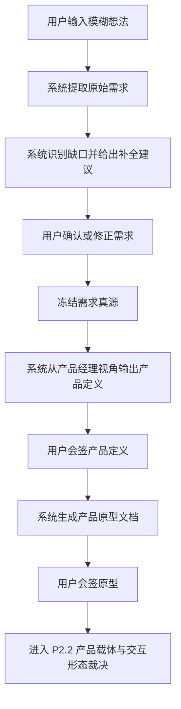
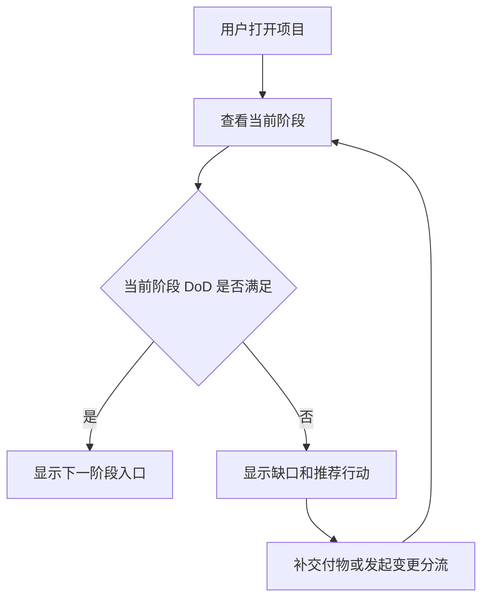
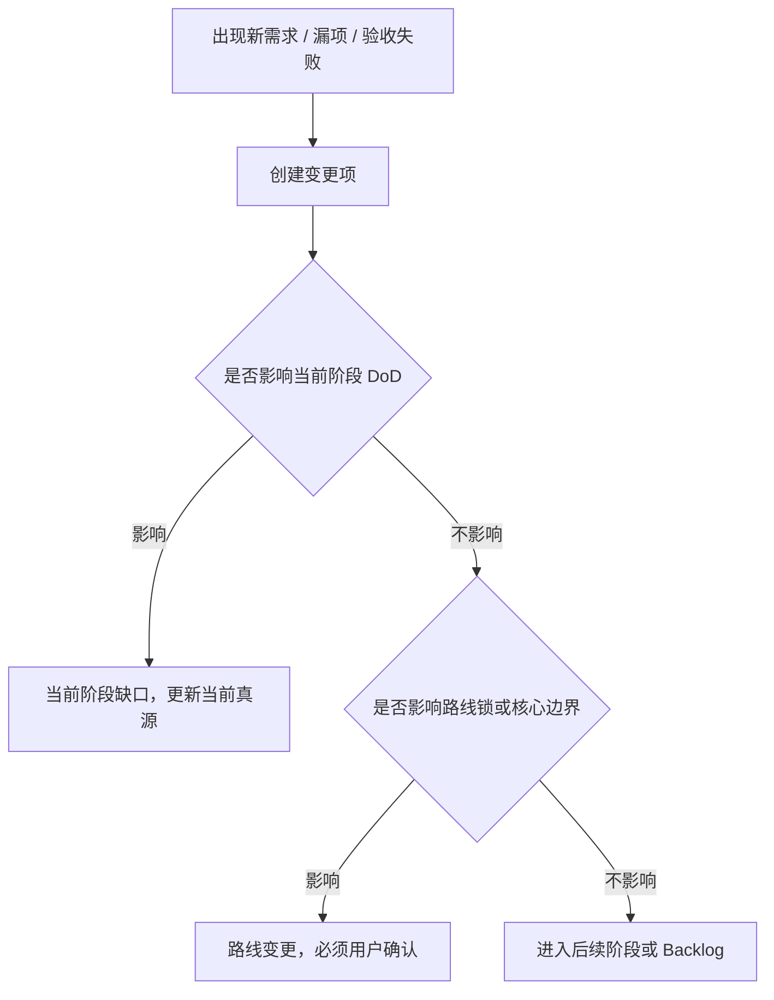

# P2 产品原型

状态：已会签（当前作为 Web / UI 候选分支输入）
记录日期：2026-07-07
会签日期：2026-07-07
上游真源：

- `docs/product-specs/001-original-requirement.md`
- `docs/product-specs/002-complete-project-blueprint.md`
- `docs/product-specs/003-user-journey.md`
- `docs/product-specs/004-capability-map.md`
- `PROJECT_ROUTE_LOCK.md`

## 1. 原型目标

本原型用于确认 NextStep 的产品结构、核心页面、主流程、关键交互和不可偏离项。

P2 只回答：

- 用户进入 NextStep 后看到哪些核心区域。
- 用户如何从模糊想法走到产品定义和阶段会签。
- 系统如何持续告诉用户当前在哪、下一步是什么、什么不能做。
- 系统如何阻止直接开发、需求偷渡和阶段漂移。

P2 不回答：

- 不定义最终视觉风格。
- 不生成高保真 UI 效果图。
- 不冻结技术栈。
- 不冻结版本路线、大里程碑或小里程碑。
- 不定义执行 Agent 的完整调用协议。

## 2. 候选产品形态

当前原型按 `Web / UI` 候选分支展开，采用项目驾驶舱作为该候选分支的建议主工作面，而不是当前正式主路线。

这是一份候选分支原型，不等于当前正式主路线。

产品界面以项目状态为中心，聊天或 AI 对话只是辅助输入。用户每次进入项目，首先看到的不是空白聊天框，而是：

- 当前项目是什么。
- 当前阶段是什么。
- 当前阶段是否允许推进。
- 当前缺什么交付物。
- 下一步推荐行动是什么。
- 当前有哪些风险或变更需要处理。

## 3. 信息架构

```text
NextStep
├─ 项目列表
├─ 项目创建 / 需求入口
├─ 项目驾驶舱
│  ├─ 当前阶段
│  ├─ 下一步行动
│  ├─ 当前交付物
│  ├─ 风险与阻塞
│  └─ 变更提醒
├─ 需求工作台
│  ├─ 原始需求
│  ├─ 意图理解
│  ├─ 需求补全
│  └─ 需求冻结
├─ 产品定义
│  ├─ 项目目标
│  ├─ 目标用户
│  ├─ 核心流程
│  ├─ 范围 / 非目标
│  └─ 成功指标
├─ 产品原型会签
│  ├─ 页面清单
│  ├─ 主流程
│  ├─ 关键交互
│  ├─ 不可偏离项
│  └─ 会签结论
├─ 阶段门禁
│  ├─ 当前阶段 DoD
│  ├─ 缺口
│  ├─ 验收结论
│  └─ 下一阶段入口
├─ 交付物中心
│  ├─ PRD
│  ├─ 原型
│  ├─ UI 设计真源
│  ├─ 技术方案
│  ├─ 里程碑计划
│  └─ 验收报告
└─ 变更分流
   ├─ 新需求
   ├─ 漏项
   ├─ 验收失败
   ├─ 分流结论
   └─ 更新后的真源入口
```

## 4. 核心页面

| 页面 | 用户目标 | 系统责任 | 主要输出 | 不可提前做 |
|---|---|---|---|---|
| 项目列表 | 找到或创建项目 | 展示项目状态和阻塞 | 项目入口 | 不把项目状态藏在聊天里 |
| 项目创建 / 需求入口 | 输入模糊想法 | 提取目标、场景、约束和缺口 | 原始需求记录 | 不直接生成开发任务 |
| 需求工作台 | 补全并冻结需求 | 引导澄清，给出建议，记录确认 | 需求真源 | 未冻结不进入产品定义 |
| 产品定义 | 从产品经理视角构建产品 | 整合目标用户、流程、范围、非目标和验收 | PRD / 产品定义 | 不选技术栈 |
| 项目驾驶舱 | 知道当前在哪和下一步 | 聚合阶段、交付物、风险、动作 | 当前状态卡 | 不用聊天流替代状态 |
| 产品原型会签 | 确认页面和流程是否正确 | 展示页面清单、主流程和关键交互 | 原型会签结论 | 未会签不进入产品载体裁决 |
| 阶段门禁 | 判断是否能推进 | 对照 DoD 输出通过、退回、需讨论或阻塞 | 门禁记录 | 不允许软通过 |
| 交付物中心 | 找到当前真源和证据 | 管理 PRD、原型、设计、技术和验收文档 | 交付物索引 | 不把草稿当已验证真源 |
| 变更分流 | 处理新需求或漏项 | 判断影响并分流 | Change Request | 不偷渡进当前闭环 |

## 5. 主流程

### 5.1 从模糊想法到产品原型



### 5.2 项目驾驶舱日常使用



### 5.3 变更分流



## 6. 关键交互

### 6.1 AI 不是只追问，而是给建议

当用户表达模糊时，系统不能只问“你想怎么做”，而要输出推荐判断：

- 我理解你的真实目标是。
- 当前缺少哪些信息。
- 我建议先按哪个方向收敛。
- 如果你确认，我会把它记录为当前真源。

### 6.2 所有推进动作都要绑定阶段门禁

进入下一阶段前，系统必须展示：

- 当前阶段交付物是否存在。
- 当前 DoD 是否满足。
- 哪些项未通过。
- 下一阶段允许做什么。
- 下一阶段仍然禁止做什么。

### 6.3 聊天结果必须沉淀为真源

AI 对话中确认的事实不能只留在聊天里，必须被写入对应真源：

- 原始需求写入需求真源。
- 产品判断写入产品定义。
- 页面和流程写入产品原型。
- 设计规范写入 UI 设计真源。
- 技术判断写入技术方案。
- 范围变化写入变更请求。

### 6.4 执行按钮默认受锁控制

当缺少版本路线、大里程碑、小里程碑或执行任务包时，系统不应允许用户直接进入执行，而应提示：

```text
当前还不能执行。
原因：缺少可验收小里程碑。
下一步：完成版本与里程碑拆解。
```

### 6.5 用户确认必须有后果

用户点击确认后，系统必须明确：

- 哪份真源被确认。
- 进入了哪个阶段。
- 哪些内容被锁定。
- 后续如需修改应走哪个变更入口。

## 7. 项目驾驶舱状态卡

驾驶舱首页至少展示以下状态卡：

| 状态卡 | 内容 | 判断口径 |
|---|---|---|
| 项目状态 | 项目名称、定位、目标用户 | 来自产品定义 |
| 当前阶段 | 生命周期阶段、里程碑、状态 | 来自路线锁 |
| 下一步 | 推荐行动和原因 | 来自阶段 DoD 缺口 |
| 当前交付物 | 已完成、待确认、缺失 | 来自交付物中心 |
| 风险阻塞 | 风险、阻塞、未决问题 | 来自验证和变更记录 |
| 变更提醒 | 新需求、漏项、后续需求 | 来自 Change Request |

## 8. 阶段门禁展示规则

门禁结论只能是：

- 通过：全部 DoD 满足，可进入下一阶段。
- 退回：关键交付物不满足，需要回到当前阶段修复。
- 需讨论：存在产品取舍或边界风险，需要用户判断。
- 阻塞：缺少外部输入或关键条件，不能继续。

不允许出现：

- “基本可以”但缺少证据。
- “先开发再补文档”。
- “顺便把新需求加进去”。
- “做个 MVP 先跑起来”替代完整路线。

## 9. 不可偏离项

- 若未来恢复当前 `Web / UI` 候选分支，NextStep 才以项目驾驶舱为中心，聊天只是辅助入口。
- 原始需求不能直接生成执行任务。
- 需求未冻结，不允许进入产品定义。
- 产品定义未会签，不允许进入产品原型。
- 产品原型未会签，不允许进入产品载体裁决。
- `P2.2` 未裁决，不允许进入正式 UI 会签。
- UI 设计真源未确认，不允许进入工程实现。
- 技术方案未确认，不允许进入里程碑实施。
- 版本路线未确认，不允许拆小里程碑。
- 小里程碑未定义 DoD，不允许生成执行任务包。
- 新需求必须进入变更分流。
- 阶段门禁必须明确通过、退回、需讨论或阻塞。

## 10. P2 原型会签标准

用户会签本原型时，需要确认：

- 当前 `Web / UI` 候选分支是否应采用项目驾驶舱作为主工作面。
- 页面清单是否覆盖从模糊需求到交付归档的主链路。
- 主流程是否符合真实项目开发顺序。
- 阶段门禁是否足以防止 AI 项目漂移。
- 变更分流是否能阻止新需求污染当前闭环。
- 不可偏离项是否可以作为后续 UI 设计和开发约束。

## 11. P2 结论

P2 产品原型建议冻结为：

> 在当前 `Web / UI` 候选分支下，NextStep 以项目驾驶舱为核心，把需求入口、需求冻结、产品定义、原型会签、阶段门禁、交付物中心和变更分流串成一条可追溯主流程。系统的每次推荐、确认和推进都必须更新项目真源，并受当前阶段门禁约束。

本文已会签；当前仅作为 `Web / UI` 候选分支输入。当前正式主路线已改为 `Skill 主载体 + 文档真源承载`；若未来需要恢复可视化工作面，再以 `docs/product-specs/006-product-carrier-decision.md` 和后续变更真源为准。
