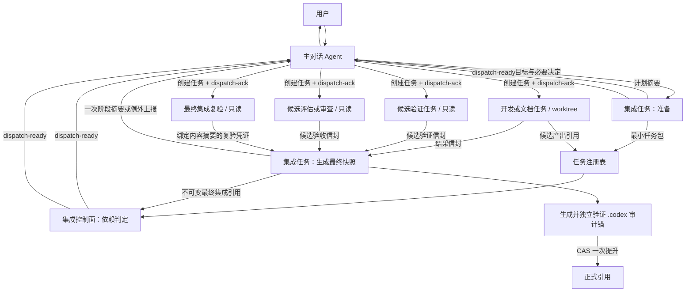

# S3 主对话 Agent 编排与上下文隔离设计

状态：已迁移，历史设计与复审证据
记录日期：2026-07-13
所属阶段：S3 Skill 交互真源
变更入口：`docs/change-requests/002-main-conversation-agent-orchestration.md`

## 1. 设计目标

用户在 Codex 的一个长期主对话中调用 NextStep，由主对话 Agent 持续澄清目标、接收决定并推动项目落地。开发、文档、测试、评估、审查、验证和集成在隔离任务中完成，执行过程不得回灌主对话。

本设计保护的是主对话的语义稳定性和用户心流，而不是以节省 Token 为目标。即使后台产生大量代码、日志、测试证据和审查讨论，主对话仍只保留用户目标、已确认决定、当前阶段、阻塞事项和下一决策点。

## 2. 已选方案

采用：`三层职责 + 扁平调度 + 独立任务隔离 + 项目真源通信`。

- 逻辑上分为主对话 Agent、集成 Agent、执行 Agent 三层职责。
- 物理上由主对话 Agent 扁平创建和调度独立 Codex 任务，不要求 Agent 递归创建下一级 Agent。
- 修改型任务使用独立 Codex task 和 worktree；测试、评估、审查等任务默认只读。
- 项目事实通过正式真源、任务注册表和最小检查点传递，不通过复制完整聊天传递。

不采用以下方案：

- 仅使用同一 Codex 任务内的普通 subagent：执行结果仍可能进入当前任务上下文，不足以满足严格隔离目标。
- 自建通用多 Agent 运行时：会重复 Codex 已提供的任务、Agent 和 worktree 能力，超出 NextStep 的产品职责。
- 三级递归 Agent 调度：依赖嵌套深度和父子上下文传播，增加恢复、权限和故障定位复杂度。

## 3. Codex 能力边界与宿主预检

Codex task、worktree、自定义 Agent、任务读取和归档是候选宿主能力，不得在未验证当前宿主、版本、项目和权限组合前视为既成保证。每次建立或恢复执行计划时必须先完成两阶段 `capability-preflight`，并绑定宿主标识、能力版本、项目、检测时间和有效期：

1. `host-bootstrap`：主对话只检查宿主当前暴露的任务创建、查询、消息、环境和归档能力描述，不读取项目文件，也不假定集成任务已经存在。
2. `project-probe`：只有 `host-bootstrap` 证明独立任务可创建和查询后，主对话才创建一次性隔离探针任务；探针验证项目级 worktree 起点、候选物化、验证隔离、控制信封往返、恢复、项目外不可变凭证、审计锚定和正式引用 CAS，并只返回预检结果信封。

若 `host-bootstrap` 无法证明隔离任务可用，不得为了完成预检而退回同一主任务读取项目或执行项目探针，只能进入 `manual-isolated` 或 `blocked`。

预检至少逐项判定：

| 能力 | 通过证据 | 缺失时处理 |
|---|---|---|
| 独立项目任务创建与继续 | 可创建隔离 task，并能以任务 ID 继续或读取状态 | 转为用户显式创建独立任务；若无法建立独立任务则阻塞 |
| 修改型 worktree 与精确起点 | 能从任务包声明的不可变基线或指向该基线的已有分支启动 | 先由集成任务物化已有分支再创建；仍不能保证起点则阻塞修改任务 |
| 候选产出物化 | 能生成不可变提交或具有稳定摘要的等价只读快照 | 禁止进入独立验证和集成 |
| 验证任务隔离 | 能使用宿主只读约束，或在一次性隔离副本中验证不可变候选且丢弃所有写入 | 无法防止验证修改被测对象时阻塞；不得仅凭角色提示词宣称只读 |
| 控制信封传递与确认 | 能向主对话发送机器可读控制信封，并返回确认 | 转为用户显式传递最小控制信封；无法确认则阻塞自动推进 |
| 派发去重与创建回执 | 宿主支持幂等创建键，或能以单写者台账和可查询任务标记可靠恢复“已创建但未确认”窗口 | 不允许 `full` 自动派发；转为用户显式创建并确认，无法绑定则阻塞 |
| 结果读取与恢复 | 能按任务 ID 读取结构化结果，恢复未确认控制消息 | 转为人工提供结果信封；无法绑定任务 ID 和产物摘要则阻塞 |
| 项目外复验凭证 | 能不可变保存、读取并校验凭证摘要，绑定验证任务身份、控制代际和内容快照 | 可由用户显式提供只读凭证进入 `manual-isolated`；无法保证不可变和身份绑定则阻塞 |
| 审计锚定提交 | 能基于已复验内容快照生成仅修改允许 `.codex` 审计路径的提交，并独立校验路径白名单、凭证摘要和父快照 | 无法在项目根形成最终验证留痕时阻塞正式提升 |
| 正式引用 CAS 与恢复 | 能以预期基线 CAS/快进到指定审计锚提交，失败后保持待提升且可安全重试 | 只能由用户显式执行且提供引用结果时进入 `manual-isolated`；无法防止覆盖并发基线则阻塞 |
| 成功任务归档 | 能在集成成功后归档指定任务 | 保留已完成任务可见并标记待人工归档，不阻塞交付 |

预检结论只能是：

- `full`：所有强制能力可用，且不存在无法恢复的“任务已创建但确认未持久化”窗口，允许计划内自动调度。
- `manual-isolated`：自动控制能力缺失，但仍能通过用户显式创建独立任务或传递控制信封保持上下文和文件隔离。
- `blocked`：无法保证独立任务、不可变候选、最终独立复验或消息身份绑定，禁止继续执行。

串行同任务执行不是静默降级路径。只有用户明确接受降低上下文隔离等级后才可作为另一个方案重新分流；此时不得声称满足本设计的严格隔离验收。

NextStep 负责 Codex 未直接提供的项目编排语义：

- 把用户决定转换成最小任务包。
- 维护任务 ID、基线、依赖、状态和幂等规则。
- 限制主对话只接收内部控制信封、集成 Agent 的阶段摘要和例外上报。
- 通过项目真源和最小检查点恢复项目状态。
- 在路线变化、验收失败等决策点暂停推进并回到用户。

因此，Codex 的独立任务和 worktree 是执行容器，不自动等同于上下文防火墙。上下文隔离必须由 NextStep 的调度协议、读取规则和结构化消息契约共同保证。

## 4. 三层职责

### 4.1 主对话 Agent

主对话 Agent 是唯一用户沟通入口，只负责：

- 澄清用户目标和约束。
- 展示计划摘要、阶段状态、阻塞和下一决策点。
- 接收用户决定并转换成最小调度指令。
- 按已确认计划扁平创建、继续或归档 Codex 后台任务。
- 接收集成 Agent 的内部控制信封、阶段摘要和需要用户决策的例外上报。

主对话 Agent 不得：

- 读取或修改项目文件。
- 开发、测试、评估、审查、验证或合入产出。
- 读取执行任务的完整对话、日志、代码差异或测试输出。
- 根据未持久化的聊天决定宣称项目事实已经生效。

### 4.2 集成 Agent

集成 Agent 同时承担执行前准备和执行后集成，但不能自我批准：

- 执行前读取路线锁、当前计划和相关真源。
- 生成计划摘要、依赖图和最小任务包。
- 检查任务的文件边界是否互斥，安排串行或并行顺序。
- 执行后读取产出和候选验证结论，处理冲突并生成不可变的最终集成快照。
- 为依赖已满足的任务生成 `dispatch-ready` 控制信封，并持久化其确认状态。
- 最终内容快照预先包含全部业务/产品真源、任务注册表、检查点、复验前验证留痕和受门禁状态；独立复验后只允许追加经独立白名单校验的 `.codex` 审计锚，集成 Agent 最终以 CAS 一次提升到该锚定提交。
- 向主对话返回一次结构化阶段摘要。

集成 Agent 不得代替独立测试、评估或审查 Agent 批准自身集成结果。

### 4.3 执行 Agent

执行 Agent 是按任务创建的短期角色，包括开发、文档、测试、验证、评估、审查和恢复任务：

- 每个 Agent 只承担一个边界明确的任务包。
- 修改型任务在独立 worktree 中工作，不直接写主工作区。
- 测试、评估、审查和恢复任务默认只读；需要检查待集成修改时，从任务包声明的候选提交、补丁或 worktree 快照启动，不读取不明确的活动工作区。
- 不继承完整主对话，也不直接联系用户。
- 信息不足时返回结构化缺口，不自行扩大范围。
- 只向集成任务提供结构化结果和证据引用。

## 5. 扁平调度流程

图中的三层是职责分层，不代表物理上的三级嵌套。主对话 Agent 根据集成任务生成的任务包，直接调度各独立任务；执行 Agent 不负责创建下一级 Agent。

## 6. 上下文防火墙

### 6.1 最小任务包

子任务只能收到完成当前任务所需的字段：

| 字段 | 作用 |
|---|---|
| 任务 ID | 唯一标识、幂等和去重 |
| 控制身份 | `plan_generation`、`task_attempt`、派发控制消息 ID 和任务包摘要 |
| 项目根 | 指向唯一绝对项目根 |
| 基线版本 | 防止在错误状态上执行或合入 |
| 目标 | 描述单一、可验收的结果 |
| 必要决定 | 只包含与当前任务有关的用户确认 |
| 输入真源 | 允许读取的正式文件及版本 |
| 依赖与候选产出 | 前置任务及待验证提交、补丁或快照引用 |
| 修改边界 | 允许修改与禁止修改范围 |
| 输出要求 | 产物、结果信封和证据位置 |
| 验收标准 | 成功、失败和阻塞判定 |
| 上报规则 | 何时停止并请求主对话决策 |

完整聊天、其他任务过程、无关用户偏好和内部推理不得进入任务包。

### 6.2 结果信封

执行结果、候选验证、产品评估、审查和最终复验信封都必须包含同一套控制身份。最小结果包含：

- 任务 ID、`plan_generation`、`task_attempt`、派发控制消息 ID、任务包摘要、基线和最终状态。
- 不可变候选提交或等价快照引用及内容摘要；活动 worktree 路径只能作为诊断位置，不能作为待验证产物身份。
- 验收结论与证据位置。
- 风险、阻塞和未完成项。
- 是否需要用户决定及其最小问题描述。

原始日志、完整代码差异、长测试输出和完整执行对话保留在对应任务或项目证据中，不进入主对话。

集成控制面采纳任何结果前，必须先读取持久化最高代际并校验控制身份：

- 低于最高 `plan_generation` 或最低有效 `task_attempt` 的结果确定性标记为 `stale-result`，不得满足依赖、触发后续派发、进入最终快照或更新正式状态。
- 同代际但任务包摘要、派发控制消息 ID、基线或产物摘要不一致的结果标记为 `identity-conflict` 并阻塞该任务。
- `stale-result` 可以按保留策略写入隔离诊断证据，但不得进入用户可见阶段结论；其迟到不改变任何活动状态。
- 候选验证、评估和审查结论除控制身份外，还必须绑定被验证候选摘要；最终复验凭证必须绑定最终内容快照摘要。

### 6.3 内部调度控制信封

内部控制面与用户可见对话必须分离。依赖状态只能由读取任务注册表的集成控制面判定；主对话不读取注册表，而是接收机器可读的 `dispatch-ready` 信封。

`dispatch-ready` 至少包含：

| 字段 | 约束 |
|---|---|
| `schema_version` | 控制信封版本，不兼容版本必须拒绝 |
| `control_message_id` | 本次控制消息唯一 ID |
| `plan_id` / `task_id` | 绑定计划和待创建任务 |
| `plan_generation` / `task_attempt` | 单调控制代际；同一计划或任务只能增加，不能回退 |
| `task_package_ref` / `task_package_digest` | 指向不可变任务包并校验内容 |
| `project_id` / `environment_requirement` | 指定项目与 local、worktree 或只读要求 |
| `immutable_base_ref` | 待执行或待验证的不可变基线 |
| `dependency_evidence` | 前置任务 ID、状态、产物摘要和证据引用 |
| `dedup_key` | 由计划、任务、任务包摘要和基线生成，创建任务前与宿主任务标记共同去重 |
| `expires_at` / `invalidated_by` | 过期时间和使信封失效的基线或计划变化 |
| `ack_required` | 必须为真，禁止无确认派发 |

控制握手如下：

1. 集成控制面持久化依赖满足事实和 `dispatch-ready` 后，才向主对话发送该信封。
2. 主对话只校验信封结构、当前计划标识、有效期、控制确认台账摘要和宿主中可查询的任务标记，不读取项目文件。
3. `full` 模式下，主对话使用宿主幂等键或等价的可恢复单写者流程创建一次独立任务，并返回 `dispatch-ack`；确认至少包含控制消息 ID、去重键、创建结果、宿主任务 ID、实际环境和时间。若宿主不能消除或恢复“已创建但未确认”窗口，禁止进入 `full`，改走 `manual-isolated`。
4. 集成控制面收到并持久化 `dispatch-ack` 后，才把任务标记为已派发。
5. 确认超时可以重发同一控制消息，但不得生成新去重键；主对话先按宿主任务标记恢复既有任务和原确认，只有确认不存在既有任务时才允许创建。无法可靠判断时停止自动派发，不得冒险重复创建。
6. 信封过期、计划变化、基线变化或任务包摘要不一致时，主对话返回拒绝确认；集成控制面重新判定依赖并生成新的控制消息。

`dispatch-ready` 和 `dispatch-ack` 可以进入主对话 Agent 的最小机器控制上下文，但默认不渲染给用户，也不携带日志、代码差异、测试输出或推理。

### 6.4 控制代际与撤销墓碑

`dedup_key` 只解决同一尝试的重复派发，不能解决旧基线与新基线使用不同键时的乱序。控制面必须额外维护单调代际：

- 每个计划有从 1 开始、只能递增的 `plan_generation`；每个任务在该代际内有从 1 开始、只能递增的 `task_attempt`。
- 集成控制面是代际唯一产生者。计划、基线、任务包或依赖语义变化时，先持久化新的代际和一条不可变 `generation-advance` 撤销墓碑，再生成新代际的 `dispatch-ready`。
- `generation-advance` 至少包含控制消息 ID、计划 ID、新 `plan_generation`、受影响任务及其最低有效 `task_attempt`、取代的基线/任务包摘要、原因、产生时间和确认要求。
- 主对话维护最小控制缓存，只记录每个计划已确认的最高 `plan_generation`、每个任务最高 `task_attempt`、墓碑消息 ID 和确认；该缓存不是项目文件，不包含执行内容。
- 主对话收到 `generation-advance` 后，先持久化本地最高代际并返回 `generation-ack`。此后无论消息到达顺序如何，低于最高代际或最低有效尝试的 `dispatch-ready` 都必须确定性拒绝，即使其 `dedup_key` 从未出现。
- 新代际的 `dispatch-ready` 只有在对应 `generation-ack` 已持久化后才可发送。若墓碑确认丢失，集成控制面重发同一墓碑；主对话返回原确认。
- 同一代际但互相冲突的墓碑、代际跳跃且缺少前序证明、或本地缓存无法恢复时，主对话停止自动派发并请求 `recovery-ready`，不得猜测当前代际。

恢复任务必须把持久化控制台账压缩为 `generation-snapshot`：包含每个活动计划和任务的最高有效代际、所有未确认墓碑及摘要。主对话先合并该快照，再重放 `dispatch-ready`；集成控制面也必须先合并该快照，再重放结果、验证和审查信封。墓碑和更高代际始终优先于低代际派发或结果消息。

### 6.5 主对话摘要

主对话默认只接收集成 Agent 的一次阶段摘要：

- 当前阶段和阶段结论。
- 进行中、待集成和阻塞数量。
- 已完成的可验收结果。
- 关键风险和证据引用。
- 需要用户决定的事项。
- 下一决策点或下一阶段动作。

单个执行 Agent 的普通排队、开始和完成通知不进入主对话。仅以下情况允许例外上报：

- 任务阻塞且现有真源无法裁决。
- 独立验收失败。
- 路线或范围需要改变。
- 涉及不可逆操作、安全风险或显著成本。
- 用户主动要求查看特定细节。

用户要求展开时，应新建只读解释任务并返回针对性摘要；不得把完整后台历史倒入主对话。

## 7. 项目状态与恢复

项目状态由正式真源、任务注册表和最小会话检查点共同承载。聊天不是项目事实真源。

最小检查点只记录：

- 项目与当前阶段。
- 已确认且已持久化的关键决定。
- 尚未持久化的决定。
- 活动任务 ID、状态和依赖。
- 当前阻塞和下一决策点。
- 当前真源基线标识。

主对话被关闭、压缩或重开后，先执行 `host-bootstrap`。独立任务能力可用时再创建只读恢复任务；恢复任务对照路线锁、当前计划、正式真源、控制消息台账和最近验证记录，返回最小 `recovery-ready` 控制信封。若只能进入 `manual-isolated`，由用户显式创建该恢复任务并提供信封；主对话始终不直接读取这些文件。

恢复时先合并 `generation-snapshot` 和所有未确认 `generation-advance`，再处理未确认的 `dispatch-ready`：低于最高有效代际的直接拒绝；已存在相同去重键和宿主任务 ID 的，补发原 `dispatch-ack`；确认不存在且信封仍有效的，创建一次；存在性无法可靠判断的，停止自动派发并进入 `manual-isolated` 或 `blocked`；已过期或基线变化的，拒绝并交回集成控制面重算。只有检查点与真源冲突且现有证据无法裁决时，才按需读取相关旧聊天片段。

## 8. 状态、幂等与故障处理

任务至少使用以下状态：`已准备`、`待派发`、`派发待确认`、`排队中`、`执行中`、`待候选验证`、`待集成`、`待最终复验`、`待正式提升`、`已集成`、`阻塞`、`失败`、`已归档`。

- 所有任务、消息和集成动作使用唯一 ID 与基线版本。
- 控制消息的状态转换以持久化确认台账为准；普通任务通知不能驱动依赖任务创建。
- `generation-advance` 墓碑和更高 `plan_generation` / `task_attempt` 优先于任何低代际 `dispatch-ready`，状态不得回退。
- 结果、候选验证、评估、审查和最终复验信封必须通过同一代际校验；低代际消息只可作为隔离诊断证据。
- 重复、延迟或乱序消息不得造成重复修改、重复派发或状态倒退。
- 执行失败或超时时，隔离 worktree 可以废弃，不改变主项目正式状态。
- 验证失败时不得合入，不得包装为完成；进入修复循环或上报用户决定。
- 集成冲突由集成 Agent 在任务边界内处理；任何冲突处理、重放、基线变化或内容变化都会生成新的最终集成摘要，并使此前最终复验结论失效。
- 用户关键决定只有在精确最终集成快照独立复验通过、正式提升完成且集成 Agent 返回持久化确认和版本标识后才正式生效。

### 8.1 精确最终集成产物复验

集成与正式状态提升必须按以下顺序执行：

1. 执行 Agent 将候选产出物化为不可变提交或具有稳定摘要的等价快照。
2. 独立验证、评估和审查任务按要求验证该候选，并在结果信封中绑定候选摘要。
3. 集成 Agent 在隔离的集成分支或等价暂存区处理冲突，把所有计划内业务/产品真源、会签状态、阶段状态、项目内任务状态、检查点和复验前验证留痕纳入不可变“最终内容快照”。快照预先写入唯一 `verification_run_id` 和最终复验清单，但不伪造尚未产生的最终结论。
4. 独立最终复验 Agent 从该精确快照启动，先校验控制代际，再验证完整内容、基线、所需门禁和候选验证继承关系，并在项目外不可变证据位置生成“复验凭证”。凭证至少绑定控制身份、`verification_run_id`、最终内容快照摘要、预期正式基线、结论、证据引用、验证者任务 ID 和时间。
5. 集成 Agent 基于最终内容快照生成一个“审计锚定提交”，只允许修改 `.codex/verification-report.md`、`.codex/operations-log.md` 和本任务专属 `.codex/reviews/` 路径，写入最终结论、复验凭证摘要、最终内容快照摘要和验证任务 ID；不得修改任何产品真源、会签/阶段状态、任务注册表或检查点。
6. 独立审计锚验证器检查：锚定提交的父提交等于最终内容快照；差异只命中审计白名单；写入字段与项目外凭证逐项一致；业务/真源子树摘要与最终内容快照一致。验证器生成项目外不可变“锚定证明”，绑定锚定提交摘要和复验凭证摘要。
7. 正式提升的唯一输入是“审计锚定提交摘要 + 锚定证明摘要 + 预期正式基线”。只有复验凭证和锚定证明均通过、控制代际仍有效、当前正式基线仍等于预期值时，集成 Agent 才能提交提升事务。
8. 提升事务只允许对正式引用执行 compare-and-swap、快进或等价原子引用移动，一次提升到审计锚定提交；提升后不得再写入或改写任何项目文件。
9. 若需要解决冲突、重写内容、补写非白名单项目状态或改变基线，复验凭证与锚定证明立即失效，返回第 3 步生成新的最终内容快照和 `verification_run_id`。若仅审计锚字段错误，废弃该锚并从同一最终内容快照重新执行第 5、6 步。
10. CAS 失败时状态保持 `待正式提升`，不得发送成功摘要或归档任务；重新读取正式基线后，基线不变可安全重试同一锚定提交，基线变化则按第 9 步失效重做。
11. 提升成功后的允许副作用仅限项目内容之外：发送用户可见阶段摘要、更新宿主任务运行状态和按能力归档任务。这些副作用必须引用已提升审计锚和最终内容快照摘要，失败时可重试，但不得回写项目内容。

最终复验 Agent 和审计锚验证器都必须独立于生成内容快照与锚定提交的集成 Agent。集成 Agent 可以运行诊断性验证，但不能替代任一独立结论。

## 9. 任务可见性与归档

- 后台任务在活动期间可以出现在 Codex 任务列表中。
- `capability-preflight` 确认归档能力可用时，完成且正式提升成功的后台任务自动归档。
- 主任务列表默认只保留主对话、当前活动任务和阻塞任务。
- 归档任务保留可追溯性，可以按任务 ID 查看或恢复。
- 未集成、失败或仍有未裁决风险的任务不得自动归档为成功状态。

## 10. 权限与职责分离

- 主对话 Agent 无项目文件读写职责。
- 修改型执行 Agent 只写自己的隔离 worktree 和允许范围。
- 测试、验证、评估、审查和恢复 Agent 默认只读。
- 集成 Agent 是集成暂存区、主工作区和正式真源的唯一写入口，但在最终独立复验通过前不得提升正式状态。
- 集成 Agent 不能自我批准；开发或文档产出至少需要独立验证。
- 涉及产品与交互要求时追加独立评估；高风险、阶段出口或发布判断追加独立审查。
- 只有候选验证和绑定精确最终集成摘要的独立复验全部通过后，集成 Agent 才能更新正式状态。

## 11. 验收标准

| 验收项 | 通过标准 | 失败示例 |
|---|---|---|
| 主对话职责 | 只沟通、决策和调度，不读写项目文件 | 主对话直接修改代码或审查差异 |
| 语义隔离 | 后台日志、代码差异和完整对话不进入主对话 | 执行任务输出被整段回灌 |
| 扁平调度 | 主对话直接调度独立任务，不依赖三级递归 | 集成 Agent 必须递归创建执行 Agent 才能工作 |
| 修改隔离 | 修改型任务使用独立 task/worktree | 多个任务直接改同一主工作区 |
| 唯一写入口 | 只有集成 Agent 更新主工作区和正式真源 | 执行或审查 Agent 直接更新正式状态 |
| 职责分离 | 集成结果经过独立验证，不能自我批准 | 集成 Agent 单独宣布自己的结果通过 |
| 最小通信 | 任务包、结果信封和阶段摘要字段受控 | 通过完整聊天传递项目背景 |
| 调度握手 | 依赖由集成控制面判定，以 `dispatch-ready` / `dispatch-ack` 幂等派发 | 主对话轮询注册表或凭普通完成消息创建任务 |
| 控制代际 | 主对话按墓碑和单调代际拒绝乱序旧信封 | 新旧基线仅靠不同去重键区分 |
| 结果代际 | 集成控制面拒绝低代际执行和验收结果 | 已撤销任务的迟到结果进入最终快照 |
| 例外上报 | 只有阻塞、失败或决策点打断用户 | 普通任务状态持续打断主对话 |
| 恢复一致性 | 从真源与检查点恢复，不默认加载旧聊天 | 压缩后依靠模型记忆猜测状态 |
| 幂等性 | 重复或乱序消息不重复修改或倒退状态 | 重复完成消息触发二次合入 |
| 最终产物复验 | 复验凭证绑定内容快照，审计锚只追加 `.codex` 结论且经独立范围验证，CAS 一次提升 | 最终结论只存项目外或审计锚改动业务真源 |
| 宿主预检 | 每个计划或恢复周期都有有效 capability preflight | 把未核验的宿主组合能力当作保证 |
| 归档 | 能力可用时成功提升后自动归档，否则明确待人工归档 | 未集成任务被归档成成功 |

## 12. 非目标

- 不把 NextStep 建设成通用多 Agent 平台。
- 不替换 Codex 的 task、Agent、worktree 或权限运行时。
- 不在 S3 冻结具体实现语言、存储、API 或 Codex 配置字段。
- 不以减少 Token 作为产品目标或验收项。
- 不允许用提示词声明代替可验证的任务、状态和消息边界。
- 不因本设计确认而自动会签 007、008、009 或原 S3 正文。

## 13. 迁移与阶段门禁

本设计已由用户确认，并已完成向 S3 正式待会签材料的小步迁移。本文自迁移完成后只作为 CR 002 的历史设计来源与独立复审证据，不再承载当前详细交互协议，也不得覆盖正式待会签材料；当前唯一详细交互协议是 `docs/design-docs/s3-skill-interaction-source.md`。迁移目标包括：

- `docs/product-specs/007-s3-skill-interaction-contract.md`
- `docs/product-specs/008-downstream-interaction-product-acceptance-contract.md`
- `docs/architecture/009-s4-technical-input-supplement.md`
- `docs/design-docs/s3-skill-interaction-source.md`
- `docs/exec-plans/active/s3-skill-interaction-source.md`
- `PROJECT_ROUTE_LOCK.md` 及相关索引和留痕

上述迁移已经完成。首轮迁移包独立复审发现的“双真源”P1 正通过本状态与引用归属修订闭合；修订后仍需重新复审。007、008、009 与 S3 正文仍需分别会签；在迁移复审和四份会签全部完成前，不得进入 S4。
