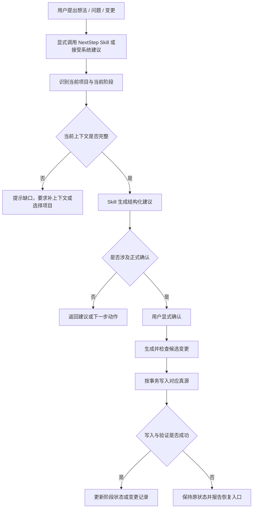
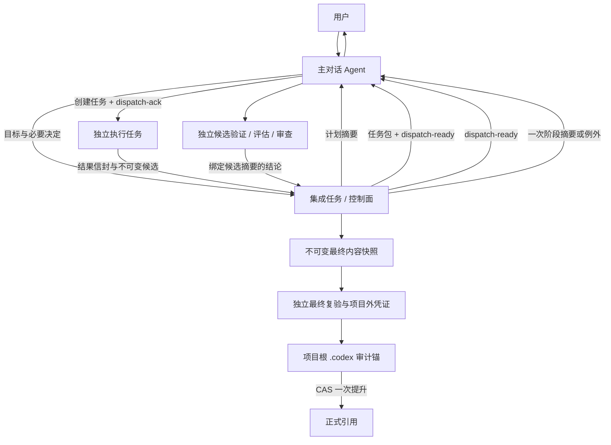

# S3 Skill 交互真源

状态：已会签
记录日期：2026-07-10
会签日期：2026-07-13
所属阶段：S3 Skill 交互真源
上游真源：

- `docs/product-specs/002-complete-project-blueprint.md`
- `docs/product-specs/003-user-journey.md`
- `docs/product-specs/004-capability-map.md`
- `docs/product-specs/005-stage-document-contracts.md`
- `docs/product-specs/006-product-carrier-decision.md`
- `docs/product-specs/007-s3-skill-interaction-contract.md`
- `docs/product-specs/008-downstream-interaction-product-acceptance-contract.md`
- `docs/architecture/p2-technical-prep.md`
- `PROJECT_ROUTE_LOCK.md`

## 1. 文档目标

本文用于定义在 `Skill 主载体 + 文档真源承载` 路线下，用户如何实际使用 NextStep，以及正式项目事实如何从对话沉淀为真源。

本文必须回答：

- 用户从哪里调用 NextStep。
- 主对话、集成和执行三层职责如何在扁平调度中保持隔离。
- 何时由用户显式调用，何时由系统建议进入流程。
- Skill 如何识别当前项目和当前阶段。
- Skill 能自动建议什么，不能自动决定什么。
- 最小任务包、结果信封、控制信封和恢复消息如何约束自动推进。
- 用户确认后的内容回写到哪份真源。
- 条件不满足时，系统如何阻止继续推进。

## 2. 明确非目标

本文不做以下内容：

- 不定义 Web 页面结构或高保真 UI 设计。
- 不定义具体 Skill 参数、MCP 协议字段或 API 结构。
- 不冻结技术栈、数据库、部署方案或模型供应商。
- 不拆版本路线、大里程碑或小里程碑。
- 不生成真实执行任务包，只定义任务包、控制信封和结果信封的交互契约。
- 不给出最终验收结论。

## 3. 交互定位

当前路线固定为：

| 项目 | 当前结论 |
|---|---|
| 主交互载体 | `Skill / 聊天入口` |
| 真源承载方式 | `项目文档真源 + PROJECT_ROUTE_LOCK.md + 对应阶段真源文档` |
| 协作模型 | `三层职责 + 扁平调度 + 独立任务隔离 + 项目真源通信` |
| Web 路线 | 当前暂停，不进入主路线 |
| MCP / API | 后续集成面 |

核心原则：

- Skill 负责推进。
- 文档真源负责冻结事实。
- 聊天记录不能替代正式真源。
- 主对话 Agent 是唯一用户入口，只沟通、决策和扁平调度，不读取或修改项目文件。
- 开发、文档、测试、评估、审查、验证和集成在独立任务中完成，普通执行消息不进入主对话。
- 本协议保护的是主对话语义稳定性和用户心流，不以减少 Token 为目标。

### 3.1 三层职责与物理调度

| 逻辑职责 | 允许行为 | 禁止行为 |
|---|---|---|
| 主对话 Agent | 澄清目标、展示计划摘要、接收决定、扁平创建/继续/归档独立任务、接收控制信封与阶段摘要 | 读取或修改项目文件；开发、测试、评估、审查、验证、集成；读取完整后台对话、日志或差异 |
| 集成 Agent | 读取路线锁和真源、生成任务包与依赖图、维护任务注册表和控制台账、检查候选结论、生成不可变最终内容快照和审计锚、以 CAS 提升正式引用 | 直接联系用户；代替独立验证、评估或审查批准自身产出 |
| 执行 Agent | 在一个边界明确的独立任务中完成开发、文档、测试、验证、评估、审查或恢复，并返回结构化结果 | 继承完整主对话；扩大任务范围；直接修改主工作区或正式状态；直接联系用户 |

三层是职责分层，不是三级递归 Agent。主对话 Agent 依据集成控制面持久化的任务包和 `dispatch-ready`，直接创建各独立任务；执行 Agent 不创建下一级 Agent。修改型任务使用独立 task/worktree，测试、评估、审查和恢复任务默认只读；只读无法由宿主保证时，必须在一次性隔离副本中执行并丢弃写入，否则阻塞。

## 4. 入口与触发方式

### 4.1 主入口

用户在支持 Skill 的 Agent 或聊天环境中调用 NextStep，并持续通过同一个主对话 Agent 沟通。执行 Agent 和集成 Agent 不得绕过主对话向用户提问、要求确认或发送普通状态消息。

### 4.2 触发规则

| 场景 | 规则 |
|---|---|
| 用户主动想推进项目 | 允许显式调用 NextStep Skill |
| 系统识别到适合进入 NextStep 流程 | 只能“建议进入”，不能静默自动执行 |
| 涉及正式会签、冻结或分流 | 必须用户显式确认后才能落盘 |
| 当前项目或当前阶段不明确 | 禁止继续推进，先要求用户确认上下文 |
| 用户已确认阶段目标或执行计划 | 计划内开发、文档、测试、评估、审查与集成任务可由主对话按控制信封自动分派，不逐次请求确认 |
| 路线、范围、不可逆动作、安全、显著成本或验收结论发生例外 | 暂停自动推进，只由主对话请求用户决定 |

### 4.3 不允许的触发方式

- 不允许在用户无感知的情况下默认静默执行正式流程。
- 不允许未识别项目就直接写入真源。
- 不允许把普通对话自动包装为已会签结论。

## 5. 当前项目与当前阶段识别

### 5.1 项目识别规则

每次进入正式流程前，Skill 必须先明确：

- 当前项目名称或唯一标识。
- 当前项目的规范化绝对项目根路径。
- 当前项目是否已有路线锁和当前阶段真源。
- 本次对话属于继续推进、创建新项目，还是处理变更。

项目定位必须遵守：

- 当前工作区只有一个项目根时，可将该工作区根作为候选项目根，但进入写入流程前仍要向用户展示并确认。
- 存在多个候选项目、同名项目或符号链接时，必须展示规范化绝对路径供用户选择，不能只按项目名称匹配。
- 用户给出的项目标识无法唯一解析时，进入 `项目不明确` 阻塞状态。
- 目标项目不在当前允许工作区、不可读或不可写时，禁止回写，只能输出待应用的候选变更和恢复条件。
- 选定项目后，本轮所有读写路径必须限制在该项目根内；发现路径逃逸时立即阻塞。

若项目不明确，Skill 必须先输出：

```text
当前无法继续推进。
原因：未识别你要操作的项目。
下一步：请选择已有项目，或确认创建新项目。
```

### 5.2 当前阶段识别规则

Skill 必须优先读取：

1. `PROJECT_ROUTE_LOCK.md`
2. 当前阶段对应的正式真源
3. `.codex` 中最近的验证与操作留痕

Skill 不能只凭聊天上下文猜测当前阶段。

### 5.3 项目上下文确认

进入任何正式写入前，Skill 必须向用户展示：

```text
当前项目：NextStep
项目根：/absolute/path/to/NextStep
当前阶段：S3 Skill 交互真源
本次动作：修改 S3 交互真源
```

用户未确认项目根或本次动作时，只能继续讨论，不能写入。

## 6. 主流程

### 6.1 从想法到真源回写



### 6.2 阶段推进中的常见动作

| 用户意图 | Skill 应做什么 | 输出结果 |
|---|---|---|
| 想补全需求 | 识别目标、场景、约束、非目标缺口 | 需求补全草案 |
| 想知道现在卡在哪 | 对照路线锁和当前真源检查缺口 | 当前阶段缺口与下一步 |
| 想会签当前文档 | 提炼待确认要点与影响范围 | 会签前摘要 |
| 想新增需求 | 判断是否影响当前闭环 | 变更分流建议 |
| 想直接开发 | 阻止跳阶段并指出缺失真源 | 回退到正确节点的说明 |

### 6.3 扁平编排主流程



普通任务的排队、开始和完成通知只能进入任务注册表或对应任务，不得驱动依赖创建，也不得进入主对话。依赖满足由集成控制面根据持久化任务注册表判断；主对话只消费结构化控制信封，不读取项目注册表或项目文件。

### 6.4 最小任务包

每个独立任务只能收到完成当前任务所需的字段：

| 字段 | 约束 |
|---|---|
| 任务 ID 与控制身份 | 包含 `plan_generation`、`task_attempt`、派发 `control_message_id` 和任务包摘要，用于幂等、代际与身份校验 |
| 项目与基线 | 唯一绝对项目根、不可变基线和环境要求；防止在错误项目、活动工作区或错误版本执行 |
| 目标与必要决定 | 单一可验收目标，只包含本任务需要的已确认决定 |
| 输入真源与依赖 | 允许读取的正式文件、前置任务及候选提交或等价快照摘要 |
| 修改边界 | 明确允许修改、禁止修改和是否只读 |
| 输出与验收 | 产物、结果信封、证据位置、成功/失败/阻塞判定 |
| 上报规则 | 只有现有真源无法裁决的阻塞或需要用户决定时停止并返回最小问题 |

完整主对话、其他任务过程、无关用户偏好、原始日志、长测试输出和内部推理不得进入任务包。

### 6.5 结果信封与身份校验

执行结果、候选验证、产品与交互评估、独立审查和最终复验都必须返回结构化结果信封，至少包含：

- 任务 ID、`plan_generation`、`task_attempt`、派发 `control_message_id`、任务包摘要、不可变基线和最终状态。
- 不可变候选提交或等价只读快照引用及内容摘要；活动 worktree 路径只能用于诊断，不能作为产物身份。
- 对应验收结论、证据引用、风险、阻塞、未完成项及是否需要用户决定。
- 候选验证、评估和审查必须绑定被验证候选摘要；最终复验必须绑定不可变最终内容快照摘要与预期正式基线。

集成控制面采纳任何结果前必须读取持久化最高代际并校验控制身份：

- 低于最高 `plan_generation` 或最低有效 `task_attempt` 的结果标记为 `stale-result`，不得满足依赖、触发派发、进入最终快照或更新正式状态；其迟到不改变活动状态。
- 同代际但任务包摘要、派发 `control_message_id`、基线或产物摘要不一致的结果标记为 `identity-conflict` 并阻塞该任务。
- `stale-result` 只可按保留策略进入隔离诊断证据，不进入用户可见阶段结论。

### 6.6 `dispatch-ready` / `dispatch-ack`

集成控制面只有在依赖满足事实和任务包均已持久化后，才能发出 `dispatch-ready`。该信封至少包含：

| 字段 | 约束 |
|---|---|
| `schema_version` / `control_message_id` | 标识兼容版本和唯一控制消息；不兼容版本必须拒绝 |
| `plan_id` / `task_id` | 绑定计划与待创建任务 |
| `plan_generation` / `task_attempt` | 单调代际，只能增加不能回退 |
| `task_package_ref` / `task_package_digest` | 指向不可变任务包并校验内容 |
| `project_id` / `environment_requirement` | 绑定项目和 local、worktree 或只读要求 |
| `immutable_base_ref` / `dependency_evidence` | 绑定不可变基线及前置状态、产物摘要和证据 |
| `dedup_key` | 由计划、任务、任务包摘要和基线生成，并与宿主任务标记共同去重 |
| `expires_at` / `invalidated_by` | 标记过期时间和使信封失效的计划、基线或任务包变化 |
| `ack_required` | 必须为真，禁止无确认派发 |

主对话只校验信封结构、当前计划、有效期、控制缓存摘要和宿主中可查询的任务标记，不读取项目文件。`full` 模式下，主对话使用宿主幂等键或等价可恢复单写者流程只创建一次独立任务，并返回 `dispatch-ack`；确认必须绑定原 `control_message_id`、`dedup_key`、创建结果、宿主任务 ID、实际环境和时间。集成控制面持久化该确认后，任务才进入已派发状态。

确认超时只允许重发同一控制消息和去重键。主对话必须先恢复已有宿主任务及原确认，确认不存在时才可创建；无法可靠判断“已创建但未确认”窗口时停止自动派发，进入 `manual-isolated` 或 `blocked`。过期、基线变化、计划变化或任务包摘要不一致时返回拒绝确认，由集成控制面重算。

### 6.7 单调代际、墓碑与恢复

`dedup_key` 只能防止同一次尝试重复创建，不能阻止旧基线与新基线的不同键乱序。控制面必须同时维护：

- 每个计划从 1 开始且只递增的 `plan_generation`，以及每个任务在该代际内从 1 开始且只递增的 `task_attempt`。
- 计划、基线、任务包或依赖语义变化时，集成控制面先持久化新代际和不可变 `generation-advance` 撤销墓碑，再发新代际任务。
- `generation-advance` 必须绑定控制消息 ID、计划 ID、新代际、受影响任务的最低有效尝试、被取代的基线/任务包摘要、原因、时间和确认要求。
- 主对话先持久化最高代际和墓碑摘要，再返回 `generation-ack`；新代际 `dispatch-ready` 只有在该确认已持久化后才能发送。
- 低代际信封无论到达顺序或去重键是否出现都必须确定性拒绝。同代际冲突墓碑、无前序证明的代际跳跃或控制缓存无法恢复时停止派发，不得猜测。

恢复任务把持久化控制台账压缩为 `generation-snapshot`，至少包含各活动计划/任务的最高有效代际、所有未确认墓碑和摘要。主对话与集成控制面都必须先合并快照和墓碑，再分别重放 `dispatch-ready` 或结果/验收信封；更高代际和墓碑始终优先。

主对话关闭、压缩或重开后，先在不读项目文件的前提下完成宿主能力启动检查；随后由独立只读恢复任务对照路线锁、当前计划、正式真源、控制台账和最近验证记录，返回最小 `recovery-ready`。恢复时：低代际信封拒绝；已有相同去重键和宿主任务 ID 时补发原 `dispatch-ack`；确认不存在且仍有效时只创建一次；存在性无法判断时进入 `manual-isolated` 或 `blocked`。完整旧聊天仅在检查点与真源冲突且现有证据无法裁决时按需读取。

### 6.8 默认安静与按需展开

主对话默认只接收集成 Agent 的一次阶段摘要，内容限于当前阶段与结论、进行中/待集成/阻塞数量、已完成的可验收结果、关键风险与证据、待用户决定事项和下一决策点。只有以下情况允许例外上报：

- 任务阻塞且现有真源无法裁决。
- 独立验收失败。
- 路线或范围需要改变。
- 涉及不可逆操作、安全风险或显著成本。
- 用户主动要求查看特定细节。

用户要求展开时，应创建独立只读解释任务并返回针对性摘要，不把完整后台历史倒入主对话。完成且正式提升成功的后台任务在宿主能力可用时自动归档；未集成、失败或仍有风险的任务不得归档为成功，归档失败只标记待人工归档，不改写正式产物结论。

### 6.9 不可变最终内容快照与正式提升

候选验证通过不等于最终集成通过。正式状态提升必须严格按以下顺序执行：

1. 修改型执行任务把候选物化为不可变提交或具有稳定摘要的等价只读快照。
2. 独立验证、产品与交互评估及必要的独立审查分别验证该候选，结果信封绑定候选摘要与完整控制身份。
3. 集成 Agent 在隔离暂存区处理冲突，将全部计划内业务/产品真源、会签与阶段状态、项目内任务注册表、最小检查点和复验前验证留痕纳入不可变“最终内容快照”。快照预先包含唯一 `verification_run_id` 和最终复验清单，但不得伪造尚未产生的最终结论。
4. 独立最终复验任务从该精确快照启动，先校验 `plan_generation`、`task_attempt`、派发消息和任务包身份，再验证完整内容、基线、门禁及候选结论继承关系，并在项目外不可变位置生成复验凭证。凭证至少绑定控制身份、`verification_run_id`、最终内容快照摘要、预期正式基线、结论、证据引用、验证任务 ID 和时间。
5. 集成 Agent 只可从该已复验内容快照生成一个审计锚定提交。锚只允许修改 `.codex/verification-report.md`、`.codex/operations-log.md` 和本任务专属 `.codex/reviews/` 路径，写入最终结论、凭证摘要、内容快照摘要和验证任务 ID；不得修改产品真源、会签/阶段状态、任务注册表或检查点。
6. 独立审计锚验证任务检查锚的父快照、路径白名单、字段与项目外凭证一致性，以及业务/真源子树摘要保持不变；通过后在项目外生成绑定锚摘要和凭证摘要的不可变锚定证明。
7. 正式提升的唯一输入是审计锚定提交摘要、锚定证明摘要和预期正式基线。只有凭证与锚定证明均通过、控制代际仍有效且正式基线匹配时，集成 Agent 才能以 compare-and-swap、快进或等价原子引用移动一次提升到锚定提交。
8. 提升后禁止补写项目内容。允许副作用仅限项目外发送阶段摘要、更新宿主任务状态和归档，并且必须引用已提升审计锚与最终内容摘要。

任何冲突处理、结果重放、基线变化、内容变化或非审计白名单补写都会使旧复验凭证和锚定证明失效，必须生成新的最终内容快照和 `verification_run_id` 后重新复验。只有审计锚字段自身错误时，才可保持最终内容快照不变并重新生成、验证锚。

CAS 失败时保持 `待正式提升`，不得发送成功摘要或归档为成功。重新读取后正式基线未变，可以安全重试同一锚；正式基线已变，旧凭证与锚均失效，回到生成最终内容快照的步骤。项目外凭证不能替代项目根 `.codex` 留痕，项目根审计锚也不能替代独立复验。

## 7. 真源回写规则

| 确认内容 | 必须回写的位置 | 不允许的做法 |
|---|---|---|
| 原始需求与问题定义 | `docs/product-specs/001-original-requirement.md` | 只留在聊天里 |
| 项目蓝图与产品边界 | `docs/product-specs/002-complete-project-blueprint.md` | 只说“已经确认”但不改真源 |
| 用户旅程与能力边界 | `docs/product-specs/003-user-journey.md`、`docs/product-specs/004-capability-map.md` | 口头补充却不落盘 |
| 主载体与交互形态裁决 | `docs/product-specs/006-product-carrier-decision.md` | 在聊天里改口径但不更新正式文档 |
| Skill 路线交互规则 | `docs/design-docs/s3-skill-interaction-source.md` | 只靠聊天上下文维持 |
| 新需求、漏项、范围变化 | 对应 Change Request 真源 | 直接并入当前闭环 |

原则：

- 先确认，再回写。
- 未回写，不算正式真源。
- 已会签真源的修改必须走变更入口。

### 7.1 正式写入事务

正式回写必须按以下顺序执行：

1. 读取目标文件最新版本并记录基线标识；Git 项目优先使用当前文件内容与 `HEAD` / 工作区状态作为基线证据。
2. 生成候选变更，展示目标项目根、目标文件、影响摘要和会签后果。
3. 用户显式确认本次变更。
4. 写入前再次检查目标文件是否相对基线发生变化；已变化则进入 `版本冲突`，不得覆盖。
5. 在不覆盖无关用户改动的前提下应用全部候选变更。
6. 运行格式、字段、路线锁和阶段门禁验证。
7. 只有全部写入与验证成功后，才能更新会签状态、阶段状态或变更记录。

这里的事务性指业务状态的逻辑原子性：多文件场景不承诺底层文件系统天然支持跨文件原子提交。只要任一目标文件写入或验证失败，整次正式变更就视为未生效，且不得提交会签或阶段状态。

### 7.2 失败与回滚原则

- 单文件写入失败：该文件保持原状态，报告失败原因和可重试入口。
- 多文件部分写入：不得更新任何会签或阶段状态；列出已写入和未写入文件，优先只回退本轮 Skill 自己写入且能安全识别的变更。
- 版本冲突：保留用户现有改动，重新读取后生成新的候选变更，不强制覆盖。
- 验证失败：保留“未通过”结论，提供失败证据；不得包装为已会签或门禁通过。
- 无法安全回退：立即阻塞并请求用户处理，不得使用破坏性 Git 命令。

## 8. AI 自动建议边界

Skill 可以自动做的事：

- 整理用户表达。
- 识别关键缺口。
- 给出阶段判断建议。
- 生成会签前摘要。
- 给出变更分流建议。
- 提示当前不能继续的原因。

Skill 不可以自动决定的事：

- 冻结需求。
- 会签原型或后续阶段真源。
- 通过或退回阶段门禁。
- 最终分类变更请求。
- 替用户切换项目并覆盖真源。

## 9. 必须用户显式确认的节点

| 节点 | 为什么必须确认 |
|---|---|
| 需求冻结 | 会影响后续产品定义边界 |
| 产品定义会签 | 会冻结目标用户、范围与非目标 |
| 原型会签 | 会冻结后续交互边界 |
| 载体裁决 | 会决定后续阶段主路线 |
| 变更最终分类 | 会决定新需求是否污染当前闭环 |
| 阶段门禁结论 | 会决定是否允许进入下一阶段 |

## 10. 多项目切换规则

- Skill 不得默认把当前聊天里的新话题并入已有项目。
- 当用户未指明项目时，Skill 必须要求选择已有项目或创建新项目。
- 项目切换后，本轮回写只能落到该项目对应真源。
- 若用户想同时比较多个项目，Skill 只能做只读摘要，不得同时修改多个项目真源。

## 11. 阻塞与异常状态

| 状态 | 表现 | 必须给出的输出 |
|---|---|---|
| 项目不明确 | 不知道当前在操作哪个项目 | 要求用户选择项目或创建项目 |
| 路线锁缺失 | 无法判断当前阶段 | 先补路线锁，不允许继续推进 |
| 当前阶段真源缺失 | 阶段所需文档不存在 | 指出缺失文档和回退节点 |
| 门禁未通过 | 用户想直接进入下一阶段 | 明确为什么不能继续、缺什么 |
| 变更未分流 | 用户把新需求插入当前闭环 | 先进入 Change Request |
| 已会签内容需修改 | 变更将覆盖既有真源 | 走正式变更流程 |
| 项目根不唯一 | 同名项目或多个候选工作区 | 展示规范化绝对路径并要求用户选择 |
| 项目不可访问 | 项目根不可读、不可写或超出允许范围 | 禁止写入，输出候选变更和权限恢复入口 |
| 版本冲突 | 确认后目标文件又发生变化 | 重新读取并重新确认，不覆盖新改动 |
| 部分写入 | 多文件变更只写入一部分 | 不更新阶段状态，报告清单并安全回退本轮改动 |
| 验证失败 | 写入后字段、格式或门禁检查失败 | 保持未通过，提供失败证据和修复入口 |
| 迟到结果 | 结果低于最高控制代际或最低有效任务尝试 | 标记 `stale-result`，隔离保留但不驱动依赖、集成或用户结论 |
| 身份冲突 | 同代际结果的任务包、派发消息、基线或产物摘要不一致 | 标记 `identity-conflict` 并阻塞，不猜测采用哪一份 |
| 控制恢复不确定 | 无法确认任务是否已创建、代际缓存缺失或墓碑冲突 | 请求 `recovery-ready`；仍无法绑定时进入人工隔离或阻塞 |
| 最终内容变化 | 已复验快照在集成、补写或基线变化后不再完全一致 | 废弃旧凭证与锚，生成新快照并重新执行最终复验 |
| 正式提升竞争 | CAS 时正式基线不再等于预期值 | 保持 `待正式提升`；基线变化时废弃旧凭证和锚，不误报成功 |

## 12. Web / UI 候选分支处理

当前保留以下候选材料，但不作为主路线：

- `docs/design-docs/p2-product-prototype.md`
- `docs/design-docs/p2-ui-design-source-requirements.md`
- `docs/design-docs/s3-ui-design-source.md`

处理原则：

- 保留历史与候选价值。
- 不进入当前正式阶段。
- 不作为技术架构的默认输入。
- 若未来恢复可视化工作面，必须重新进入路线确认或变更分流。

## 13. 验收标准

S3 会签结论只能是 `通过`、`退回`、`需讨论`、`阻塞` 之一。下表所有验收项通过，只代表本文具备提交用户会签的条件；用户确认本文后，才允许把本文标记为已会签。只有 `007 S3 Skill 交互真源补充契约`、`008 后续交互与产品验收补充契约`、`009 S4 技术输入补充契约` 和本文分别完成用户会签，才允许进入 S4。

| 验收项 | 证据 | 通过条件 | 失败条件 |
|---|---|---|---|
| 主入口与触发 | 第 4 节 | 显式调用、建议调用和禁止静默执行均明确 | 任一正式动作可以无感执行 |
| 三层职责与扁平调度 | 第 3.1、6.3 节 | 主对话只沟通/决策/调度，集成与执行职责隔离且不依赖递归 Agent | 主对话读写项目或执行 Agent 直接联系用户 |
| 上下文防火墙 | 第 6.4、6.5、6.8 节 | 最小任务包、结果信封、默认安静和例外上报边界明确 | 完整聊天、日志、差异或普通执行消息进入主对话 |
| 调度握手 | 第 6.6 节 | `dispatch-ready` / `dispatch-ack` 绑定控制消息、去重键、任务包和宿主任务身份 | 普通完成消息驱动派发或确认窗口可造成重复创建 |
| 控制代际与恢复 | 第 6.7 节 | `plan_generation`、`task_attempt`、`generation-advance` / `generation-ack` / `generation-snapshot` 能确定性拒绝旧消息 | 只靠 `dedup_key` 处理旧基线乱序或恢复时猜测代际 |
| 结果身份 | 第 6.5 节 | 低代际为 `stale-result`，同代际身份不一致为 `identity-conflict` | 已撤销结果进入依赖或最终快照 |
| 最终内容复验 | 第 6.9 节 | 不可变最终内容快照、项目外凭证、项目根审计锚、独立锚验证与 CAS 一次提升形成闭环 | 集成 Agent 自我批准、提升后补写或 CAS 失败仍报成功 |
| 项目根解析 | 第 5.1、5.3 节 | 唯一绝对项目根、同名处理、越界和权限规则完整 | 只按名称猜测或无法证明写入目标 |
| 阶段识别 | 第 5.2 节 | 路线锁、阶段真源和留痕读取顺序明确 | 依赖聊天上下文猜测阶段 |
| 主流程 | 第 6 节 | 建议、确认、候选变更、写入、验证和状态更新顺序完整 | 写入失败后仍可更新状态 |
| 真源回写 | 第 7 节 | 每类确认有唯一目标真源 | 正式事实只停留在聊天中 |
| 写入一致性 | 第 7.1、7.2 节 | 冲突、部分写入、验证失败和回滚规则完整 | 允许覆盖新改动或误报生效 |
| 自动与确认边界 | 第 8、9 节 | 自动建议和用户决策边界明确 | Skill 可自动冻结关键事实 |
| 多项目切换 | 第 10 节 | 跨项目读写边界明确 | 可同时修改多个项目或覆盖其他项目 |
| 阻塞与恢复 | 第 11 节 | 每种阻塞都有原因、状态和恢复入口 | 失败后没有可追溯处理方式 |
| 候选分支 | 第 12 节 | Web / UI 材料保留但不作为当前输入 | 候选材料被当成当前正式真源 |
| 变更入口 | 第 15 节 | 会签后修改必须进入 Change Request | 已会签内容可直接覆盖 |

## 14. 不可偏离项

- Skill 不能替代正式真源。
- 聊天记录不能替代会签记录。
- 主对话 Agent 不能读取或修改项目文件，也不能接收普通执行消息或完整后台过程。
- 项目执行必须使用扁平调度的独立任务；集成 Agent 不得自我批准。
- 控制信封、任务包、结果信封、代际/恢复和最终提升必须遵守本文唯一详细协议，不得由普通状态消息或宿主隐式行为替代。
- 未识别项目不得推进正式流程。
- 未通过门禁不得继续进入下一阶段。
- 当前主路线不得偷偷回到 `Web 项目驾驶舱优先`。

## 15. 变更入口

本文会签后如需修改入口、项目解析、确认边界、真源回写、异常处理或候选分支定位，必须在 `docs/change-requests/` 新建变更请求，并说明：

- 变更原因与来源。
- 受影响章节和上游真源。
- 是否改变用户确认边界、阶段门禁或写入安全。
- 验证方式、失败判定和是否需要重新会签。

## 16. 当前结论

S3 Skill 交互真源已在 007、008 依次会签通过后完成单独审核与用户会签，正式冻结为：

> NextStep 当前由主对话 Agent 作为唯一 `Skill / 聊天入口`，只负责沟通、决策和扁平调度；独立的集成与执行任务通过项目真源、最小任务包、控制信封和结果信封协作。主对话默认安静、按需展开，不读取或修改项目文件。所有正式确认都必须由用户显式确认并回写真源，所有正式提升都必须经过不可变最终内容快照的独立复验、项目外凭证、项目根审计锚和 CAS 一次提升。

顺序会签当时，本文单独通过不开放 S4；该后续门禁已由 009 的会签满足。

## 17. 会签记录

- 会签顺序：3 / 4；前置会签：007、008 已通过。
- 审核结论：`PASS`，未发现 P0 / P1 阻塞项。
- 会签结论：通过。
- 会签日期：2026-07-13。
- 会签来源：用户在当前会话明确要求按 `007 -> 008 -> S3 -> 009` 的依赖顺序分别审核并会签。
- 审核证据：`.codex/reviews/s3-four-signoff-sequential-review-2026-07-13/03-s3/`。
